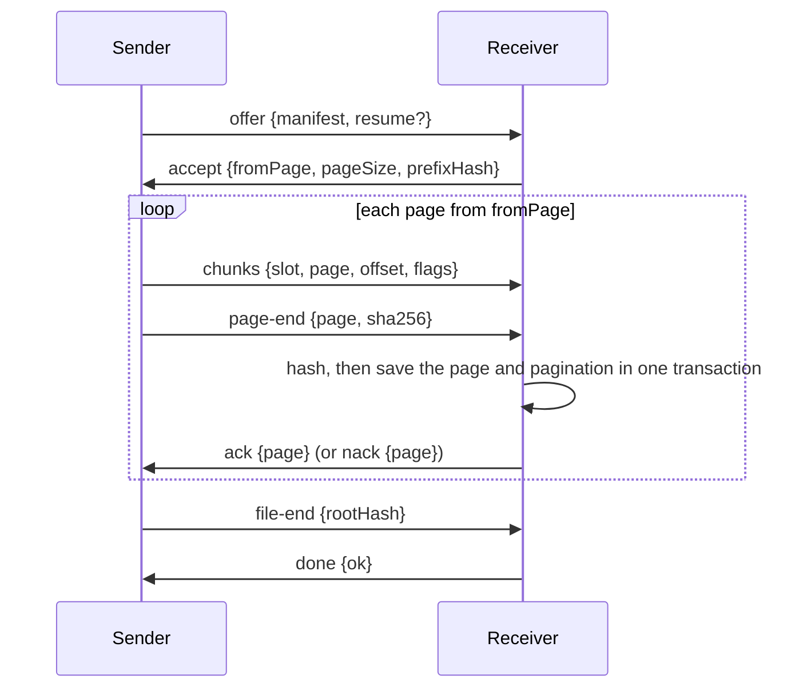

# Client

The client is the use-case layer (§17.3): one function per use case, events for the UI,  
and everything below it wired up: the protocol, sessions and history, the file queue and slot scheduler,  
pagination, resume, verification and IndexedDB storage.  
The UI imports only `src/client/client.ts`, `src/client/clientTypes.ts` and the media types they re-export.  
The client never imports the UI or a platform, and knows nothing about SDP, ICE or frame header bytes (AR-01, AR-02).

## Modules

- `client.ts`: `createClientAsync`, the public functions and the wiring.
- `connection.ts`: pairing, `hello`, the session record and its connection log, the Restore prompt's hold and Start fresh,  
  `sync`, validation, dispatch, link loss.
- `outgoing.ts`: the send queue, file preparation two at a time, `offer-batch`, the slot scheduler,  
  and moving unfinished files from other sessions to the connected device.
- `thumbnailPipeline.ts`: thumbnails made two at a time and sent as each is made, held back only by the control channel's buffer.
- `sendFile.ts`: one outgoing file on one slot, from `offer` to `done`.
- `incoming.ts`: offers and batches, pages saved then acknowledged, the final check, cancel, thumbnails.
- `protocol.ts`: the typed messages and `validateMessage`.
- `hashing.ts`: `sessionId`, `fileId`, page hashes, `prefixHash`, `rootHash`.
- `pagination.ts`: page arithmetic and the concurrency rule.
- `batches.ts`: the `offer-batch` split, the batch prompt numbers and "Accept what fits".
- `storage.ts`: every IndexedDB read and write; `batchStore.ts` and `sessionStore.ts` serialise record updates.
- `progress.ts`: batched progress events and the per-second log summaries.
- `gallery.ts`: gallery rows grouped by date taken.
- `saving.ts`: the ZIP download and full-size files, assembled from stored page Blobs and checked against their page hashes.
- `src/core/sha256.ts`: an incremental SHA-256 for the whole-file hash `crypto.subtle` can't stream.
- `fakeNetwork.ts` and `clientHarness.ts`: the in-memory network pair and the two-device test harness (CL-10).

## Creating a client

### createClientAsync

- **Signature:** `createClientAsync(options: ClientOptions): Promise<Client>`
- **Does:** reads or creates the device ID (`crypto.randomUUID()` on first run) and the settings record,  
  applies the log routing, restores unfinished files (outgoing ones become `needs-file`, incoming ones `paused`,  
  stopped ones stay stopped),  
  and schedules the storage cleanup.
- **Returns:** the `Client`.
- **Notes:** `options.createNetwork` makes one `Network` per pairing; `options.media` extracts metadata and makes thumbnails;  
  `options.platform` (e.g. `iPhone`, from `platform.devicePlatform()`) goes to the peer in `hello` (DN-07).  
  `now`, `randomId`, `storageEstimateAsync` and `persistStorageAsync` are test seams with browser defaults.

```ts
const client = await createClientAsync({
    database,
    logger: loggerController.logger,
    loggerController,
    createNetwork,
    media,
    appUrl: location.href.split('#')[0],
    defaultSettings: platform.settingDefaults(),
    platform: platform.devicePlatform(),
    isPhone: platform.kind !== 'desktop',
});
```

## Properties

### deviceId

- **Signature:** `readonly deviceId: string`
- **Does:** this browser's identity, kept in IndexedDB; site data cleared means a new one (DN-04).

### settings

- **Signature:** `readonly settings: Settings`
- **Does:** the current settings, after normalisation.

### state

- **Signature:** `readonly state: ConnectionState`
- **Does:** `idle`, `creating-offer`, `awaiting-answer`, `answering`, `connecting`, `connected`, `lost` or `closed`.

### peer

- **Signature:** `readonly peer: Peer | undefined`
- **Does:** the connected device: ID, name, display name (DN-03), session, connection, check code, protocol version  
  and platform (DN-07).
- **Notes:** undefined while not connected. `platform` is missing when the peer runs an older build or sent a value this build doesn't know.

### activeTestTools

- **Signature:** `readonly activeTestTools: readonly TestTool[]`
- **Does:** the test tools that are on, for the "Test tool active" banner.

## Pairing

### inspectCode

- **Signature:** `inspectCode(codeOrUrl: string): CodeInfo | undefined`
- **Does:** reads what a scanned or pasted code is without touching the connection.
- **Returns:** `{ kind, code, expired }`, or undefined when the text is not a pairing code.
- **Notes:** used to forward an answer opened in a new tab to the page that made the offer (HS-07).

### startPairingAsync

- **Signature:** `startPairingAsync(): Promise<{ code: string; url: string; expiresAt: number }>`
- **Does:** creates a new `Network` and its offer; state goes `creating-offer` then `awaiting-answer`.
- **Returns:** the offer to show as a QR code.
- **Notes:** rejects with `busy` while connected; a pending offer is discarded first.

### joinWithCodeAsync

- **Signature:** `joinWithCodeAsync(codeOrUrl: string): Promise<{ answerCode: string; answerUrl: string }>`
- **Does:** accepts the other device's offer; once the link connects, `hello` and `sync` run by themselves.
- **Returns:** the answer to show as a QR code.
- **Notes:** rejects with `code-invalid`, `code-expired`, `code-version` or `code-used`.

### completePairingAsync

- **Signature:** `completePairingAsync(answerCodeOrUrl: string): Promise<Peer>`
- **Does:** applies the answer, waits for the link, exchanges `hello`, opens the session and sends `sync`,  
  or emits `session-known` and waits for the Restore prompt's answer (see "Restore prompt").
- **Returns:** the peer.
- **Notes:** a wrong answer leaves the offer waiting; a peer on another major protocol version rejects with  
  `protocol-version` and "Update the app on …" (CL-01).

### cancelPairing

- **Signature:** `cancelPairing(): void`
- **Does:** discards a pending offer or answer; state goes back to `idle`.

### disconnectAsync

- **Signature:** `disconnectAsync(): Promise<void>`
- **Does:** closes the link (the network sends `bye`) and pauses running files; state goes to `closed`.

### renameAsync

- **Signature:** `renameAsync(name: string): Promise<void>`
- **Does:** saves the trimmed name and sends `name` to the peer (DN-02).
- **Notes:** rejects with `invalid-argument` outside 1–32 characters.

## Naming a file or batch

Every call about a file or batch names its session, so acting on one device's history never touches another's.  
A file is named with a `FileRef`: its `sessionId`, its `fileId`, and optionally its `direction`,  
for a file the session both sent and received (left out, the call takes the unfinished side, else the sent one).  
A `FileRecord` is a `FileRef` as it is, so the UI passes the record it shows.  
A call naming a session that has no such file (or batch) rejects with `file-not-found`.

```ts
await client.pauseAsync(fileRecord);
await client.cancelAsync({ sessionId, fileId, direction: 'in' });
const zip = await client.buildZipAsync(sessionId, selectedFileIds);
```

## File identity and files already on the other device

A file's ID is its content and its path: SHA-256 of the sampled content digest  
(§7.1: the size, then the first, middle and last 64 KiB) followed by the UTF-8 of its path in the picked folder,  
or of its name when it has none; the first 16 bytes as hex.

- The same bytes in two folders are two files, sent and received as two records.
- The same file at the same path picked twice in one selection is queued once (PK-06).
- Resume, `needs-file` matching, adopting a partial (§7.5) and the check below all go by this ID.
- Deviation from §7.1: a renamed or moved file is a new file, so it no longer resumes into its old partial;  
  that partial expires with "Keep partial files" or the user deletes it.

Every manifest also carries a `contentId`: the same hash over the content digest and the name alone, without the folder.

A receiver answers `have`, or a `have` entry in `batch-reply`, with its `rootHash` and the page size that hash was computed with,  
when it still holds (done, and its data not deleted) either:

- the file with that ID, or
- for an ID it has no record of, a file with the same `contentId` (same name and content) received in another batch of the session,  
  so a subfolder, or a single file, picked alone after its whole folder is skipped.  
  One from the same batch doesn't count, so two copies picked together in two folders are both sent.  
  Each session keeps a `contentId` index, read from storage once and added to as files finish;  
  a candidate is read again before it counts. Records from before `contentId` never match.  
A sampled ID can collide, so the sender checks before skipping:  
it hashes its whole file page by page at the receiver's page size, as state `verifying` with `note: 'checking'` ("Checking…").  
The files of a batch are checked one at a time in the background, so the accepted ones start at once;  
until its turn a file waits as `verifying` with `note: 'check-waiting'` ("Waiting to check"),  
and a file paused, canceled or restored after a reload loses either note.

- Match: the file ends `done` with `note: 'already-on-peer'`, its `rootHash` set and no data sent;  
  the UI shows `Skipped · already on <peer>`.
- Mismatch: the file is sent anyway, as with Send again,  
  and the receiver replaces its record, pages and thumbnail under the same ID.

A receiver with no record for the ID, or whose data for it was deleted (Delete, bulk Delete, Clear received files),  
takes the file as new; a record whose data was deleted is refreshed in place, never duplicated.  
`sendAgainAsync` always sends the file in full.

## Sending

### sendFilesAsync

- **Signature:** `sendFilesAsync(files: readonly File[], options?: SendFilesOptions): Promise<Batch>`
- **Does:** queues one selection as one batch (BK-01); file IDs, metadata and thumbnails are prepared two at a time,  
  just ahead of sending (BK-06).
- **Returns:** `{ batchId, files }`, with a `localId` per file; file IDs arrive later with `file-queued`.
- **Notes:** `relativePaths` keeps folder paths (PK-03).  
  Works while the link is down if a device was paired in this page; the files wait in the queue.  
  The same file (the same bytes at the same path) picked twice is queued once (PK-06).  
  A file picked again while an earlier send of it rests (stopped, paused or waiting for its `File`) moves into the new batch,  
  its old batch counting one file less, and continues from the receiver's saved pages: its offer says `resumed`,  
  so a receiver whose copy is stopped takes it. A finished one is still checked and skipped as before.

```ts
const batch = await client.sendFilesAsync(pickedFiles, {
    relativePaths: pickedFiles.map(file => file.webkitRelativePath || undefined),
});
```

### pauseAsync

- **Signature:** `pauseAsync(file: FileRef): Promise<void>`
- **Does:** stops a sending or receiving file, keeps its pages and tells the peer.
- **Notes:** a paused file is not resumed by re-pairing until `resumeAsync`; no-op for finished and stopped files (CL-06).

### resumeAsync

- **Signature:** `resumeAsync(file: FileRef): Promise<void>`
- **Does:** puts a paused outgoing file back in the queue, or asks the sender to re-offer a paused incoming one.  
  A stopped file (`pausedBy: 'stop'`) resumes on both devices, as `resumeBatchAsync` does for that one file.
- **Notes:** an outgoing file without its `File` becomes `needs-file`; no-op for active files (CL-06).  
  Resuming a stopped file rejects with `not-connected` without a connection to its device.

### cancelAsync

- **Signature:** `cancelAsync(file: FileRef): Promise<void>`
- **Does:** cancels from either side, tells the peer (TR-09), and deletes the partial file on both sides:  
  its saved pages and its pagination go, and the record ends `canceled` with no data.
- **Notes:** nothing asks whether to keep a partial.  
  No-op for finished files. A canceled file counts as canceled in its batch.

### stopBatchAsync

- **Signature:** `stopBatchAsync(sessionId: string, batchId: string, direction: Direction): Promise<number>`
- **Does:** Stop this batch, or the Total progress card's Stop, on either side (TR-12):  
  every file of the batch still moving or waiting (queued, offered, verifying or waiting for its check, active, paused)  
  ends paused with `pausedBy: 'stop'`, and the other device does the same. What arrived is kept:  
  the receiver's saved, verified pages and the sender's page hashes and pagination.
- **Returns:** how many files were stopped on this side.
- **Notes:** nothing starts from the moment it is called: the queue is held, every moving file stops at its last  
  acknowledged page and every waiting file leaves the queue at once, then the records are written.  
  A stopped file moves again only through `resumeBatchAsync`, `resumeAsync` or the sender picking it again:  
  never by itself, not even after re-pairing or a reload. Files waiting for their `File` stay `needs-file`;  
  a file still waiting for this device's Accept had nothing arrive and ends `canceled`, so a resume asks again.  
  The batch stays unfinished. The other device hears it through `stop-batch`; offers of the batch still on their way  
  get no answer, unless they say `resumed`. Works with the link down: the other device stops the batch  
  when this one's `sync` says `stopped`. An older build drops `stop-batch`, so the files that were moving are also  
  paused for it with `cancel {reason: 'paused', keepPartial: true}`, as Pause does, and it keeps their pages.  
  Rejects with `file-not-found` when this device has no such batch in that direction.

```ts
const stopped = await client.stopBatchAsync(batch.sessionId, batch.batchId, batch.direction);
```

### resumeBatchAsync

- **Signature:** `resumeBatchAsync(sessionId: string, batchId: string, direction: Direction): Promise<number>`
- **Does:** Resume this batch, or the Stopped card's Resume, on either side: the batch's stopped files move again  
  on both devices and continue from the receiver's saved pages (§7.4).
- **Returns:** how many files were resumed on this side.
- **Notes:** the other device hears it through `resume-batch` (with `fileIds` for a single file's Resume);  
  the sender sends it before its offers, which say `resumed`. A receiver also sends its `sync`,  
  so an older sender, which drops `resume-batch`, resumes from it. A sender without the file's `File`  
  (after a reload) turns it `needs-file`, and `resumeWithFilesAsync` continues it.  
  Rejects with `file-not-found` when this device has no such batch in that direction,  
  and with `not-connected` without a connection to its device.

### cancelBatchAsync

- **Signature:** `cancelBatchAsync(sessionId: string, batchId: string, direction: Direction): Promise<number>`
- **Does:** Delete what arrived, from a batch's ⋯, on either side:  
  every unfinished file of the batch (queued, offered, incoming,  
  verifying or waiting for its check, active, paused, stopped, needs-file) ends `canceled`, and the other device does the same.
- **Returns:** how many files were canceled on this side.
- **Notes:** nothing starts from the moment it is called: the queue is held, every moving file stops at its last  
  acknowledged page and every waiting file leaves the queue at once, then the records are written, not-started ones first.  
  The partial files of the canceled files are deleted on both sides (pages and pagination).  
  Picking the same files again skips the finished ones after the whole-file check (`already-on-peer`)  
  and sends the canceled and never-started ones in full, into the same records; no record is duplicated.  
  The other device hears it through `cancel-batch`; offers of the batch still on their way get no answer.  
  A file the receiver verified just as it was called stays done on both sides and counts as received.  
  Both batches finish at once: whatever their files hadn't counted yet, files the other side never heard of included,  
  counts as `canceled`, and the batch stays finished with those counts.  
  Rejects with `file-not-found` when this device has no such batch in that direction.

```ts
const canceled = await client.cancelBatchAsync(batch.sessionId, batch.batchId, batch.direction);
```

### resumeWithFilesAsync

- **Signature:** `resumeWithFilesAsync(files: readonly File[], options?: { readonly sessionId?: string }): Promise<ResumeMatch>`
- **Does:** matches re-picked files to files waiting for their `File` (§7.4 step 5).  
  A picked file fits when its content and the waiting file's own path give that file's ID,  
  so files picked one by one still find files sent from a folder; the same path wins, then the connected session.
- **Returns:** `{ matched, unmatched }`; matched files go back in the queue and resume at the receiver's page.

### sendAgainAsync

- **Signature:** `sendAgainAsync(file: FileRef): Promise<void>`
- **Does:** sends a finished file again in full, skipping the receiver's "already received" check.
- **Notes:** rejects with `file-not-found` when the `File` is no longer in this page.

### retryFailedAsync

- **Signature:** `retryFailedAsync(sessionId: string, batchId: string): Promise<void>`
- **Does:** queues the failed files of a batch again (BK-07); declined ones are offered as "send again".

### listUnfinishedElsewhereAsync

- **Signature:** `listUnfinishedElsewhereAsync(): Promise<UnfinishedElsewhere[]>`
- **Does:** while connected, finds the unfinished outgoing files (queued, offered, active, paused, needs-file)  
  of every other session, e.g. one whose receiver cleared its data and came back as a new device.
- **Returns:** one group per session, newest first: `sessionId`, `peerName`, `lastConnectedAt`, `fileCount`, `totalBytes`,  
  and `readyCount`, the files whose `File` this page still holds.
- **Notes:** empty while not connected.

### sendUnfinishedHereAsync

- **Signature:** `sendUnfinishedHereAsync(sessionIds: readonly string[]): Promise<{ readonly queued: number; readonly needsFile: number }>`
- **Does:** moves those sessions' unfinished outgoing files into the connected session as one new batch, in their original order.  
  Files whose `File` is still here are queued at once; the others become `needs-file` here, so `resumeWithFilesAsync` matches them.  
  The old records end `canceled` with `note: 'moved'`.
- **Returns:** how many were queued and how many need picking again.
- **Notes:** the receiver has no partial, so the files start at page 0, unless it adopts one by file ID and size (§7.5).  
  A second call finds nothing and returns zeros; rejects with `not-connected` without a connection.

```ts
client.on('unfinished-elsewhere', groups => {
    showMoveOffer(groups);
});
const moved = await client.sendUnfinishedHereAsync(chosenGroups.map(group => group.sessionId));
```

## Receiving

### acceptIncomingAsync

- **Signature:** `acceptIncomingAsync(file: FileRef): Promise<void>`
- **Does:** accepts a file waiting in `incoming` with "Ask before receiving" on (SP-07).
- **Notes:** answered while the link is down, the next offer of the file is accepted without asking.

### rejectIncomingAsync

- **Signature:** `rejectIncomingAsync(file: FileRef, reason: 'declined' | 'space'): Promise<void>`
- **Does:** rejects a waiting file; the sender marks it failed.

### acceptBatchAsync

- **Signature:** `acceptBatchAsync(batchId: string, options: { mode: 'all' | 'fits' }): Promise<void>`
- **Does:** answers the batch prompt (BK-03); `fits` accepts the first files, in order, that fit the free space  
  and rejects the rest with `space` (test 33).

### declineBatchAsync

- **Signature:** `declineBatchAsync(batchId: string): Promise<void>`
- **Does:** rejects every file of the batch as `declined`.

### getReceivedFileAsync

- **Signature:** `getReceivedFileAsync(file: FileRef): Promise<File>`
- **Does:** re-hashes every stored page against the hash it was saved with, one page at a time,  
  then assembles the file from the page Blobs, never reading it whole (RX-03); the viewer uses it for full-size images.
- **Returns:** a `File` with a sanitised name (RX-05), its type and its original `lastModified`.
- **Notes:** a page that doesn't match or is missing sets `note: 'damaged'`, emits `file-state`,  
  and rejects with `verify-failed`.  
  Rejects with `file-not-found` when the pages are gone (deleted by the user, or never finished).

### getThumbnailAsync

- **Signature:** `getThumbnailAsync(file: FileRef): Promise<Blob | undefined>`
- **Does:** reads the stored thumbnail, kept even after the file itself is deleted (TH-03).
- **Notes:** each file has at most one: the sender's, or one the receiver made from the verified file  
  when the sender sent none, could not make one, or its announced one never came.

### buildZipAsync

- **Signature:** `buildZipAsync(sessionId: string, fileIds: readonly string[]): Promise<Blob>`
- **Does:** builds a store-only ZIP from the stored pages with `createZipBlob`, using the CRC-32 computed as the pages arrived (SV-04).  
  It is the only way received files leave the app, because it keeps their dates:  
  each entry's modification date is the file's `lastModified` as the sender sent it,  
  and its creation date is the date taken from the metadata, left out when unknown or when it only repeats the file date.
- **Notes:** entry names keep the files' folder paths, sanitised, and clashing names get " (2)".  
  No page is read first, so the ZIP is ready at once (test 32); the unzipper checks each entry against its CRC-32.  
  Mark the files saved once the download starts.

```ts
const zip = await client.buildZipAsync(sessionId, selectedFileIds);
startDownload(zip, 'ether-photos.zip');
await client.markSavedAsync(sessionId, selectedFileIds);
```

### markSavedAsync

- **Signature:** `markSavedAsync(sessionId: string, fileIds: readonly string[]): Promise<void>`
- **Does:** sets `savedAt` the first time, counts the file as saved in its batch, and emits `file-state`.
- **Notes:** it never deletes anything; the pages stay until the user deletes them.

### computeSha256Async

- **Signature:** `computeSha256Async(file: FileRef, options?: { readonly onProgress?: (fraction: number) => void; readonly signal?: AbortSignal }): Promise<string>`
- **Does:** computes the standard whole-file SHA-256 (hex), for comparing with other tools.  
  The receiver (`direction: 'in'` in the `FileRef`, the default when both exist) hashes the stored pages in order;  
  the sender (`'out'`) hashes the `File` this page still holds.  
  One page is in memory at a time, and it yields between pages.
- **Returns:** the hash, cached in the record's `sha256` (with a `file-state` event); a cached value returns at once.
- **Notes:** `onProgress` gets the fraction done after each page; `signal` stops it with an `AbortError`.  
  Rejects with `file-not-found` when neither the pages nor the `File` are here and nothing is cached.

### deleteReceivedAsync

- **Signature:** `deleteReceivedAsync(file: FileRef): Promise<void>`
- **Does:** frees a received file's pages and emits `file-state`; the record and thumbnail stay in history.  
  An unfinished file loses its partial instead, as with `deletePartialAsync`.
- **Notes:** received data leaves the app only through this, `deleteReceivedManyAsync`, `clearSessionFilesAsync` and `clearAllAsync`.  
  A file whose data was deleted counts as not received: sending it again sends it in full, into the same record.

### deleteReceivedManyAsync

- **Signature:** `deleteReceivedManyAsync(sessionId: string, fileIds: readonly string[]): Promise<void>`
- **Does:** the same for several received files of one session (bulk Delete), one transaction and one `file-state` per file.
- **Notes:** rejects with `file-not-found`, before deleting anything, when the session lacks one of the files.

### deletePartialAsync

- **Signature:** `deletePartialAsync(file: FileRef): Promise<void>`
- **Does:** removes a partial's pages and pagination; an unfinished file becomes `canceled`.  
  While connected to its device it also sends `cancel` with reason `canceled`, so the other device deletes its copy too:  
  the receiver's pages, or the sender's pagination.
- **Notes:** for a file that isn't moving: a moving one is canceled with `cancelAsync`.

## History

### listSessionsAsync

- **Signature:** `listSessionsAsync(): Promise<SessionSummary[]>`
- **Returns:** every session, last connected first, with its unfinished-file count and whether it is connected now.

### getSessionAsync

- **Signature:** `getSessionAsync(sessionId: string): Promise<SessionSummary | undefined>`
- **Returns:** one session, with its connection log `{ connectionId, start, end, reason }`.

### listFilesAsync

- **Signature:** `listFilesAsync(options: ListFilesOptions): Promise<FileRecord[]>`
- **Returns:** a session's files in queue order, filtered by direction and states.
- **Notes:** unfinished files carry `pagination` (page X of Y, page size).

### listBatchesAsync

- **Signature:** `listBatchesAsync(sessionId: string): Promise<BatchRecord[]>`
- **Returns:** the session's batches, newest first, with received, saved, failed and canceled counts.
- **Notes:** a batch is finished (`finishedAt`) once received + failed + canceled reaches its item count.  
  Files the receiver already had count as received on both sides, canceled files (one by one or by Delete what arrived)  
  as canceled; stopped files don't count, so a stopped batch stays unfinished.  
  A file picked again in a newer batch leaves its old one, which then counts one file, and its size, less.  
  They also count their full size in the batch's bytes done on both sides, and the bytes done are kept with the batch,  
  so a bar resumed after a reload starts where it was and never moves back.  
  Retrying a failed file or resuming a canceled one takes it out of its count again and reopens the batch.  
  Batches stored before `canceled` existed read it as 0.

### listGalleryAsync

- **Signature:** `listGalleryAsync(options: ListGalleryOptions): Promise<GalleryGroup[]>`
- **Returns:** rows grouped by the day the photo was taken (as written, with its offset), newest first, "no-date" last (GL-03).
- **Notes:** filters `all`, `photos`, `videos`, `not-saved` and `failed` (GL-05);  
  statuses `waiting`, `receiving`, `received`, `saved`, `failed`, and for the sender `queued`, `sending`, `sent` (GL-04, GL-07).

### clearSessionAsync

- **Signature:** `clearSessionAsync(sessionId: string): Promise<void>`
- **Does:** deletes a session with its files, pages, batches and thumbnails.
- **Notes:** rejects with `busy` while connected to that session.

### getClearSummaryAsync

- **Signature:** `getClearSummaryAsync(sessionId: string, scope: ClearScope): Promise<ClearSummary>`
- **Returns:** what `clearSessionFilesAsync` would remove for the confirmation dialog: `finished` and `unfinished` files,  
  `notDownloaded` (received, verified, still in the app and never saved) and `bytes`, the total size of the files counted.
- **Notes:** `scope` is `sent`, `received` or `all`.

### clearSessionFilesAsync

- **Signature:** `clearSessionFilesAsync(sessionId: string, options: { readonly scope: ClearScope; readonly includeUnfinished?: boolean }): Promise<{ readonly removed: number }>`
- **Does:** removes a session's finished files of the scope (done, failed, canceled, moved),  
  with their pages, thumbnails and the batches left empty, and resets the session totals of the scope.  
  With `includeUnfinished` (always for `all`) the scope's unfinished files are canceled first and removed too:  
  when connected to that session the peer gets `cancel` with `keepPartial: false`, the slot frees and partial pages go.  
  Without it, running transfers keep running.
- **Returns:** how many file records were removed.
- **Notes:** works connected or not; the session record, its peer, the connection log and a live link stay.  
  Nothing of another session is touched; a thumbnail goes only when no record of its file is left in the session.  
  Emits `session-cleared` once; the UI then reads the session's lists again.

```ts
const summary = await client.getClearSummaryAsync(sessionId, 'received');
if (await confirmClearAsync(summary)) {
    await client.clearSessionFilesAsync(sessionId, { scope: 'received', includeUnfinished: true });
}
```

### clearAllAsync

- **Signature:** `clearAllAsync(): Promise<void>`
- **Does:** disconnects and deletes every session, file, page, batch, thumbnail and log entry.
- **Notes:** the device ID and settings stay.

## Restore prompt

When two devices that already share a session connect again, and that session holds files,  
each asks its person whether to restore the session or start fresh (UI plan §6).  
After `hello` the client emits `session-known` and holds this device's resume: it sends no `sync`,  
and keeps the peer's `sync` without applying it. A sender resumes a file only on the receiver's `sync`,  
so nothing moves on either device until both chose Restore. Start fresh from either side wins.

- No prompt when the session is new or holds no files.
- No prompt on a reconnect after link loss within the same page run,  
  once the prompt was answered there or was not needed: paused transfers resume by themselves (CL-09).  
  A Disconnect, the peer leaving, or a reload asks again.
- The prompt shows on both devices, each with its own counts.

```ts
client.on('session-known', async info => {
    const choice = await askRestoreAsync(info);
    if (choice === 'restore') {
        await client.restoreSessionAsync(info.sessionId);
    } else {
        await client.startFreshAsync(info.sessionId);
    }
});
```

### restoreSessionAsync

- **Signature:** `restoreSessionAsync(sessionId: string): Promise<void>`
- **Does:** releases the hold: sends this device's `sync`,  
  and applies the peer's when it came meanwhile, as without the prompt.
- **Notes:** with no held connection to that session (the link dropped while the prompt was open),  
  it only spares the next reconnect in this page run the prompt. Does nothing after the peer's Start fresh.

### startFreshAsync

- **Signature:** `startFreshAsync(sessionId: string): Promise<StartFreshResult>`
- **Does:** clears the session on this device like Reset this device (`clearSessionFilesAsync` with scope `all`,  
  canceling transfers in progress), then sends `session-reset {sessionId}` and releases the hold,  
  so this device's (now empty) `sync` follows the reset.
- **Returns:** `{ removed, isPeerNotified }`: the file records removed here, and whether the reset went to the peer.
- **Notes:** works with the link down too: the session record keeps `resetPending`, and the next connection with that peer  
  sends `session-reset` before anything else and asks nothing.  
  The peer clears its copy the same way, emits `session-reset` and answers its own prompt.  
  When both start fresh at once, each clears once:  
  a `session-reset` arriving after this connection already started fresh changes nothing.  
  A peer on an older build drops the unknown message and keeps its copy.

## Settings and diagnostics

### configureAsync

- **Signature:** `configureAsync(changes: Partial<Settings>): Promise<Settings>`
- **Does:** normalises and saves the settings (AP-05), reconfigures the logger and the network live (LG-05),  
  sends the new name, re-runs the cleanup when retention changed, and emits `settings`.
- **Returns:** the normalised settings.
- **Notes:** a running file keeps its page size; new files use the new one (test 22).  
  Concurrency applies as slots free; timeouts apply at once.

### configureSessionAsync

- **Signature:** `configureSessionAsync(changes: Partial<TransferSettings>): Promise<void>`
- **Does:** stores transfer overrides for the connected session; the defaults stay as they are.
- **Notes:** a key given as `undefined` removes that override, so the session falls back to the default (the panel's reset button).  
  Rejects with `not-connected` without a connection.

### getDiagnosticsAsync

- **Signature:** `getDiagnosticsAsync(): Promise<Diagnostics>`
- **Returns:** state, health, candidate pairs, the slots in use with their buffered bytes, `maxMessageSize` and the check code.

### getStorageInfoAsync

- **Signature:** `getStorageInfoAsync(): Promise<StorageInfo>`
- **Returns:** used, quota and free bytes from the storage estimate, and whether storage is persistent.

### setPeerLogs

- **Signature:** `setPeerLogs(on: boolean): void`
- **Does:** turns "Show peer's logs" on or off (DL-15).  
  While on and connected, the peer sink sends this device's `pair`, `ice`, `pairs` and `resume` entries as `log` messages,  
  and the peer's entries are appended to the logger with `peer` set to its name.

### setTestTool

- **Signature:** `setTestTool(tool: TestTool, on: boolean): void`
- **Does:** `corrupt-pages` damages the next page after it is hashed, so the receiver nacks it (test 20);  
  `drop-ack` drops the next ack (test 30); `fill-storage` makes page and thumbnail writes fail with `QuotaExceededError`.
- **Notes:** each stays listed in `activeTestTools` until turned off; emits `test-tools`.

### dropConnectionForTest

- **Signature:** `dropConnectionForTest(): void`
- **Does:** closes the link now, as if the Wi‑Fi went away; files pause and resume after re-pairing.

### on

- **Signature:** `on(name, handler): Unsubscribe`
- **Does:** subscribes to an event; a throwing handler never stops the others.

### dispose

- **Signature:** `dispose(): void`
- **Does:** closes the link, stops every timer and removes every handler.

## Events

- `state(state)`: the connection state changed.
- `peer(kind, peer)`: `connected`, `renamed` or `left`.
- `health(health)`: Good, Weak or Lost with the round-trip time.
- `batch-incoming(info)`: a batch needs an answer: its session, item count, size, free space, `fitsCount` and `spaceIsShort` (BK-03).
- `batch-progress(progress)`: a batch's done, saved, failed and canceled counts, bytes, speed and time left for the whole batch, queued files included.  
  An unfinished batch with no file moving keeps getting it for up to a minute, so its speed falls and `stalled` turns on  
  instead of freezing at the last speed; a finished batch stops.
- `thumb(fileId, sessionId)`: a thumbnail was stored.
- `file-queued(record)`: an outgoing file got its file ID and record.
- `file-incoming(record)`: a file waits for `acceptIncomingAsync` or `rejectIncomingAsync`.
- `progress(items)`: at most 10 per second per file, many files batched into one event (CL-08), never empty.  
  The sender counts acknowledged pages plus pages in flight; the receiver counts saved pages.
- `file-state(record)`: any state change.
- `file-done(record)`: a file passed the root hash check, or the peer already had it and the whole-file check matched (`note: 'already-on-peer'`).
- `file-failed(record, error)`: a file failed.
- `needs-file(record)`: the sender must pick the file again (§7.4 step 5, PK-05).
- `sync(decisions)`: resume decisions: `resume`, `restart`, `needs-file`, `adopted`, `data-lost`, `already-done`,  
  each with its session and the page it starts from.
- `session-cleared(sessionId, scope)`: `clearSessionFilesAsync` removed a session's files of that scope.
- `session-known(info)`: a known session that holds files connected again: `sessionId`, `peerName`, `lastConnectedAt`  
  (the connection before this one), `receivedCount` and `sentCount` (finished files of each side) and `unfinishedCount`.  
  This device's transfers wait for `restoreSessionAsync` or `startFreshAsync`.
- `session-reset(reset)`: the peer started fresh, so this device cleared its copy: `sessionId`, `peerName` and `removed`.
- `settings(settings)`: the settings changed.
- `test-tools(active)`: the active test tools changed.
- `unfinished-elsewhere(groups)`: once per connection, after `hello` and `sync`, when other sessions hold unfinished outgoing files;  
  the same groups as `listUnfinishedElsewhereAsync`.
- `error(error)`: an error not tied to a call, e.g. storage full or a failed pairing.
- `notice(notice)`: housekeeping to show once: partials older than "Keep partial files" deleted, or history trimmed.

## Speed and time left (TR-10)

The progress bar counts acknowledged pages on the sender and saved pages on the receiver.  
Speed and time left come from the live position instead: the bytes that have crossed the link,  
which is the bytes handed to the channel minus what is still buffered on the sender, and the bytes received on the receiver.  
The tracker (`progress.ts`) reads that position twice a second, so the estimate keeps moving between pages,  
even on a slow link where one page takes longer than a minute.

`rateEstimator.ts` turns the positions into a rate:

- For the first 3 s, the average since the start (from the resumed position, not from zero).
- After that, a moving average with a 5 s time constant, updated by each movement over the time since the one before,  
  so a slow link that delivers whole 64 KiB chunks every few seconds still reads at its real rate.
- While nothing moves for longer than a step usually takes, the rate shown falls with the wait, so the time left grows.
- After 10 s without movement (or three missed steps on a slow link) the file is `stalled`, and the UI says "Waiting for the connection…".

Each batch has its own rate as well, measured across its files, finished ones included,  
so a batch of many small files that each finish in under a second still gets a steady estimate.  
A batch that was idle for over 5 s (a pause, a re-pairing) measures afresh when it moves again.  
The batch's time left covers everything not yet across the link, queued files included.


`FileRecord.note` says why a file looks the way it does:  
`checking`, `check-waiting`, `already-on-peer`, `data-lost`, `adopted`, `restarted`, `storage-full`, `partial-expired`, `declined`, `no-space`, `moved`  
or `damaged` (a stored page no longer matches its hash).  
`FileRecord.sha256` holds the whole-file SHA-256 once `computeSha256Async` has computed it.  
`FileRecord.pausedBy` says who paused it: `user`, `peer`, `link`, `storage`,  
or `stop` for a file stopped with its batch on either device, which only Resume moves again (TR-12).

## Errors

Every failed call rejects with `ClientError { code, message, fileId? }` (CL-07); the UI maps `code` to text.  
Pairing codes: `code-invalid`, `code-expired`, `code-version`, `code-used`, `gathering-timeout`, `connect-timeout`, `ice-failed`.  
Others: `not-connected`, `busy`, `protocol-version`, `no-space`, `storage-full`, `file-not-found`, `file-unreadable`,  
`not-supported`, `invalid-state`, `invalid-argument`, `canceled`, `timeout`, `verify-failed` and `internal`.

## Protocol

Messages are JSON on the control channel or on a slot (1–4); requests carry `id` and replies carry `re` (CL-02).  
`validateMessage` checks the type, the channel, every field's type, the sizes (manifest ≤ 64 KiB, name ≤ 255 characters)  
and that `totalPages` matches the size; the receiver also checks that the file is known and the page is below `totalPages`.  
Every size is measured in UTF-8 bytes, as the data channel counts them: a Greek letter is two bytes, an emoji four.  
Invalid messages are logged and dropped; 10 within 10 seconds end the connection (SP-05, CL-03).  
An invalid request (one with an `id`) is answered with `error {re, reason}`, so its sender fails it at once instead of waiting,  
and the manifests of an `offer-batch` are checked one by one: a bad one is refused alone with `reject {reason: 'invalid'}`.

| Channel | Type | Direction | Fields | Reply |
| --- | --- | --- | --- | --- |
| control | `hello` | both | `protocol`, `deviceId`, `name`, `connectionId`, `platform?` (text ≤ 32; an unknown value is ignored) | — |
| control | `sync` | both | `files[]` (ongoing: `fileId`, `direction`, `name`, `size`, `pageSize`, `totalPages`, `pagesDone`, `prefixHash?`, `state`, `held?`, `stopped?`), `index`, `last` | — |
| control | `name` | both | `name` | — |
| control | `session-reset` | both | `sessionId` (Start fresh: the receiver clears its copy of the session) | — |
| control | `log` | both | `entries[]` | — |
| control | `thumb` | sender → receiver | `fileId`, `jpeg` (base64, ≤ 32 KiB) or `none: true` | — |
| slot | `offer` | sender → receiver | manifest (`fileId`, `contentId?`, `name`, `size`, `mime`, `lastModified`, `relativePath?`, `pageSize`, `totalPages`, `metadata?`, `thumb?`), `resume?`, `restart?`, `again?`, `resumed?`, `batchId?` | `accept` / `have` / `reject` / `wait` |
| slot | `accept` | receiver → sender | `fileId`, `fromPage` (on a resume, the last saved page), `pageSize`, `prefixHash?` (of the pages before `fromPage`) | — |
| slot | `have` | receiver → sender | `fileId`, `verified`, `rootHash?`, `pageSize?` (of the receiver's copy) | — |
| slot | `reject` | receiver → sender | `fileId`, `reason` (`space`, `declined`, `invalid`, `paused`), `needed?`, `free?` | — |
| slot | `wait` | receiver → sender | `fileId?` or `batchId?` | — |
| slot | `page-end` | sender → receiver | `fileId`, `page`, `sha256` | `ack` / `nack` |
| slot | `ack` / `nack` | receiver → sender | `fileId`, `page` | — |
| slot | `file-end` | sender → receiver | `fileId`, `rootHash` | `done` |
| slot | `done` | receiver → sender | `fileId`, `ok` | — |
| slot | `offer-batch` | sender → receiver | `batchId`, `index`, `last`, `files[]` (manifests), first message also `itemCount`, `totalBytes`, `sizes?` | `batch-reply` / `wait` |
| slot | `batch-reply` | receiver → sender | `batchId`, `files[]` (`fileId`, `reply`: `accept` / `have` / `reject`, `fromPage?`, `pageSize?`, `rootHash?` (with `have`), `reason?`) | — |
| slot | `cancel` | both | `fileId`, `direction` (on the cancelling device), `keepPartial`, `reason?` (`canceled`, `paused`, `failed`, `storage-full`); with `canceled` the partial is always deleted, `keepPartial` counts only for the others | — |
| slot | `cancel-batch` | both | `batchId`, `direction` (of the batch on the device that deletes what arrived) | — |
| slot | `stop-batch` | both | `batchId`, `direction` (of the batch on the stopping device) | — |
| slot | `resume-batch` | both | `batchId`, `direction` (of the batch on the resuming device), `fileIds?` (≤ 1,000; the whole batch when left out) | — |
| either | `error` | either | `re`, `reason` (the request could not be read) | — |
| slot | binary frame | sender → receiver | `{ slot, page, offset, flags }` header + chunk bytes | — |

Additions to the §17.3 table, all within protocol 1:

- `wait`: the receiver is asking its user (SP-07, BK-03); the sender stops the reply timer and waits.
- `sync.index` and `sync.last`: sync splits into messages under 60 KiB, like `offer-batch`.
- `sync` entries' `held`: paused by the user on that device, so the other side does not resume it.
- `offer.restart`: the saved pages did not match; discard them and start at page 0.
- `offer.again`: "Send again", skipping the already-received check; `offer.batchId` ties the file to its batch.
- Manifest `thumb`: a thumbnail follows on control, so the receiver doesn't make its own (TH-04).
- `thumb.none`: the sender could not make the thumbnail it announced (e.g. a HEIC its browser can't decode),  
  so the receiver makes its own as soon as the file is verified; `jpeg` is then left out.
- `reject.needed` and `reject.free`: "needs X, has Y" (TR-07); reason `paused` for a file the receiver's user paused.
- `cancel.direction` and `cancel.reason`: which of the two records the cancel is about, and whether it is a pause,  
  a failure or "Storage full" rather than a cancel.
- `error {re, reason}`: the answer to a request that could not be read at all.
- `session-reset {sessionId}`: Start fresh (see "Restore prompt"), validated like `hello` and `name`;  
  one for another session is ignored. An older build drops it as an unknown type and keeps its history.
- `cancel-batch`: Delete what arrived of a batch; the other device cancels its files of the batch and deletes their pages.
- `stop-batch` and `resume-batch`: Stop and Resume of a batch, keeping what arrived (TR-12).  
  An older build drops them as unknown types: for it, Stop also pauses the moving files with `cancel {reason: 'paused'}`,  
  so it keeps their pages, and a receiver's Resume also sends `sync`, which an older sender resumes from.  
  A new build takes such a pause for the Stop it already made; a pause never undoes a Stop.
- `sync` entries' `stopped`: stopped on that device, so a device that missed the Stop stops the batch too.
- `offer.resumed`: the user resumed the file after a Stop, or picked it again; a receiver takes it although its copy is stopped,  
  while an offer without it for a stopped file (sent before the Stop, or by an older build that missed it) gets `reject {reason: 'paused'}`.
- `accept.fromPage` below the pages the sender has acknowledged: the receiver asks for its last saved page again (§7.4);  
  every build drops the hashes from `fromPage` on and sends from there, so an older sender resumes correctly,  
  and an older receiver, which asks for the page after its last, is still understood.

### One file



- The sender keeps two pages in flight, so hashing and the receiver's write overlap with the next page.  
  Pages are saved in order, so an `ack` also covers every page before it.
- A chunk for a page other than the slot's current page is dropped and logged (TR-02).
- A hash mismatch is nacked; the sender goes back to that page and resends, up to "Page resend tries", then the file fails (TR-06).  
  No ack within "Page ack timeout" resends the same way; a late ack for an earlier attempt is ignored (CL-02).
- A page already saved with the same hash is acked again without writing (§7.5),  
  except the last saved page asked for again on a resume: its new copy replaces the stored one once it matches.
- A root hash mismatch restarts the file from page 0 once; a second mismatch fails it with `verify-failed` (§7.3).
- A zero-byte file goes from `accept` straight to `file-end` (TR-11).
- Backpressure: before every chunk the sender waits for `network.waitDrainedAsync(slot)` (TR-04).
- The scheduler keeps files in pick order, one per slot, up to "Concurrent files" (Auto: 2, or 4 when the batch's median file is under 5 MB);  
  running files never change slots and a lower limit lets them finish (TR-03, TR-08, CL-05, BK-05).
- Running batches share the slots, with the limits unchanged: when a slot frees, the next file comes from the batch  
  with the fewest moving files (the oldest batch on a tie), in pick order within its batch,  
  so a folder picked while another sends starts on the next free slot. A single file is a batch of its own.  
  With one batch the order is plain pick order.

### Batches

A selection of more than one file is offered with `offer-batch`: as soon as a window of prepared files is full (200),  
the rest of the batch is prepared, or the slots would sit idle.  
Each message stays under 60 KiB of UTF-8 and is answered once with `batch-reply` (BK-02).  
A message the network still refuses as too large is never waited on: the window halves until it fits,  
and a single manifest goes without its metadata summary; only a file too large even then fails, with that reason.  
An unanswered offer (a batch or a single file) is sent once more after a pause while the link is up;  
if that goes unanswered too, its files fail with "No answer from … to the batch offer" or "… to the offer of …",  
and the rest of the batch carries on.  
Metadata summaries are sanitised before they go: numbers that aren't finite or are out of range,  
unknown fields and text over the media layer's limits are left out or cut, so a file is never refused for its tags.  
The first message carries the item count, the total size and, when it fits, every file size,  
so the receiver's prompt can say how many files fit.  
The receiver asks only with "Ask before receiving" on or when the batch doesn't fit the free space;  
otherwise it accepts at once.  
Accepted files are still offered one by one on their slot, so every slot knows its file, but the receiver answers them without asking.  
A file offered on its own belongs to a batch too: when the receiver doesn't know its `batchId`, or it has none,  
the receiver records a batch for it (one more file each time another single offer of that batch arrives),  
so every received file gets `batch-progress` and a batch of one finishes like any other.

Thumbnails run ahead of the file data through the whole batch on their own pipeline (TH-02):  
once the receiver knows a file (after `batch-reply`, or after `accept` for a single file),  
its thumbnail is made, at most two at a time, and sent on the control channel as soon as it is made, so nothing is kept after sending.  
They are paced by the control channel's buffer, not by a rate: above 256 KiB queued they wait until it drains,  
so pings are never delayed (§4).  
File IDs and metadata are still prepared two at a time just ahead of sending (BK-06),  
taking turns between batches: the next file comes from the batch with the fewest files prepared ahead,  
and the 200 prepared ahead are the total for all batches.  
A batch with nothing to start offers its window with what it has prepared, without waiting for a full window.

Each received image or video gets one thumbnail.  
When the file is verified and the sender announced none, the receiver makes its own from the assembled file  
with `media.createThumbnailAsync` (TH-04).  
When the sender announced one, the receiver waits for it; a `thumb` with `none: true` (the sender couldn't decode the file)  
makes it start at once, and so does losing the link, or 15 seconds without the thumbnail.  
Whichever thumbnail is stored first stays: a late one from the sender is dropped, and `thumb` is emitted once.

## Resume (§7.4)

1. Both devices send `hello`, compute `sessionId` from the two device IDs, and reopen or create the session,  
   adding `{ connectionId, start }` to its connection log.
2. Both send `sync` with their ongoing files in this session; finished files are not synced.  
   A device asking the Restore prompt sends its `sync`, and applies the peer's, only once its person chose Restore.
3. For each file, the receiver's `pagesDone` and `prefixHash` win.  
   The receiver logs `peer sync: <name> in, <pagesDone>/<totalPages> pages` and the sender `resume fromPage=<page>`.  
   Stopped files stay stopped; a batch stopped on the other device while the link was down (`stopped` in its `sync`)  
   stops here too, unless the user resumed or picked the file again here since.
4. The sender still has the `File`: it offers it with `resume: true`, the receiver answers `accept {fromPage: pagesDone − 1, prefixHash}`  
   (page 0 when nothing is saved) with the prefix hash of the pages before `fromPage`,  
   and the sender compares the prefix with its stored page hashes, re-reading any page it has no hash for ("Checking…"),  
   then continues from there. The last saved page thus goes again: the receiver keeps its stored copy until the new one,  
   checked against the sender's hash, is written over it, so a page torn by a crash is healed.  
   Its saved count drops by that page and goes on; the lines keep the furthest they showed.  
   Files resume independently, each in a free slot, in their original queue order.
5. The sender lost the `File` (reload): the file becomes `needs-file` and `needs-file` is emitted.  
   `resumeWithFilesAsync` matches re-picked files by their content and the waiting file's path.
6. The sender's data was cleared (a new device ID, so a new session): the user picks the file again.  
   The receiver finds the partial with the same file ID and size in any session, moves it and its pages into the current session,  
   and accepts from its saved page; the sender re-reads those pages once to check `prefixHash`.  
   A mismatch sends `offer {restart: true}` and the receiver deletes the old pages.
7. The receiver lost its data: a resume offer finds nothing, so it accepts from page 0, both sides note `data-lost`,  
   and a `data-lost` sync decision is emitted.

When the receiver cleared its data it comes back with a new device ID, so a new session, and nothing resumes by itself.  
After `hello` and `sync` the client emits `unfinished-elsewhere` for the other sessions' unfinished outgoing files,  
and `sendUnfinishedHereAsync` moves them to the connected device.

A file sent again in the same session after it finished gets `have`, and once its whole hash matches  
it ends `done` with `note: 'already-on-peer'` (see "File identity and files already on the other device").  
A Stop is not a lost link: stopped files keep their saved pages too, but move again only on Resume, on either device,  
or when the sender picks the file again (TR-12).  
When the link drops, every running file pauses (`pausedBy: 'link'`), keeps its saved pages, and resumes after the next pairing  
without the UI doing anything (CL-09), in the same page run. After a Disconnect or a reload the Restore prompt asks first.

## Isolation

Each paired device has its own session, and nothing of one session reaches another device.

- Everything in memory is keyed by session: progress (session, direction and file), the files being sent and received,  
  the queue, batches, and thumbnails waiting to go or to arrive.
- A pairing with a different device never sends, offers, resumes or shows another session's files;  
  only `sendUnfinishedHereAsync` moves them, on request.  
  Pausing, resuming or canceling a file of another session changes it here only; its device hears about it when it comes back.  
  A `cancel` from the connected peer only ever touches its own session's files.
- When the link drops and a different device pairs, the old session's live state goes: running files pause (and stay paused  
  in storage until that device returns), waiting thumbnails and batch prompts are released, the session's transfer overrides  
  are dropped, and log entries buffered for the peer before the new pairing are discarded (DL-15).  
  Files the page still holds stay with their own session, so that device resumes them without picking them again.
- Events carry their session (`progress`, `batch-progress`, `file-state`, `thumb`, `sync`, `batch-incoming`),  
  and `list*` calls return only the asked session's data.  
  Every call about a file or batch names its session (see "Naming a file or batch").
- The same file sent to or received from two devices has two records, two progress entries and, when received, two sets of pages.  
  The one exception is §7.5: a receiver whose sender came back as a new device (its data was cleared)  
  adopts the partial with the same file ID and size, after the sender proved it has the same pages.

## Storage

Everything goes through `storage.ts` (CL-04), in the stores defined by `src/core/database.ts`.

- `settings`: key `device` holds the device ID, key `settings` the settings record with its schema version (AP-05).
- `sessions`: one record per paired device: peer, its platform from its last `hello` (`peerPlatform`, kept when a later  
  `hello` has none), last connected, connection log, transfer overrides and totals,  
  and `resetPending` while a Start fresh made with the link down waits to reach the peer.
- `files`: one record per file and direction, key `[sessionId, fileId, direction]`.  
  Unfinished files carry `pagination` (`pageSize`, `totalPages`, `currentPage`, `pagesDone`, `prefixHash`, `slot`, `lastConnectionId`).  
  The sender's pagination also holds the hashes of acknowledged pages; the receiver's holds the running CRC-32,  
  and the one before its last page, so a resume that sends that page again still knows its CRC  
  (when neither is known, after pages were lost from storage, the ZIP reads the pages for it).  
  A received file keeps its CRC-32 once done, for the ZIP, and the page size of its `rootHash`, for a sender's check.  
  Both sides keep the file's `contentId`.
- `pages`: the receiver's page Blobs with their SHA-256, key `[sessionId, fileId, pageIndex]`.
- `batches`: one record per batch and side, with counts and, on the receiver, the user's answer to the prompt.
- `thumbs`: thumbnails, key `[sessionId, fileId]`, kept after the file is deleted.

Write rules (§7.2):

- The receiver writes a page Blob and the updated pagination in one transaction, then acks.  
  A crash mid-page loses only that page; part-pages in memory are discarded on any interruption.  
  On a resume the last saved page is sent again and written over its stored copy.
- The sender saves its pagination on acks at most once a second, and at once when the file pauses or stops.
- `done` removes the pagination and keeps `rootHash` and `completedAt` in the one write that marks the file done.
- Every other change to a stored record (the thumbnail flag, `savedAt`, `note`, `sha256`, freeing pages on delete,  
  pausing, resuming, cancelling, expiring a partial) is a read-modify-write of the record as it is now,  
  in one transaction (`patchFileAsync`), and checks its state there:  
  a late thumbnail or a slow write never puts back an older copy, so a finished file never falls back to `active`.
- A page write failing with `QuotaExceededError` pauses the file as "Storage full", keeps the saved pages,  
  emits `error` with `storage-full` and tells the sender (PW-08).
- Partials older than "Keep partial files" are deleted with a `notice`; finished records beyond "Keep history" days  
  or count per session are trimmed, except files whose data is still in the app;  
  each is read again in the deleting transaction, so one received again meanwhile stays.
- Received data is deleted only by `deleteReceivedAsync`, `deleteReceivedManyAsync`, `clearSessionFilesAsync` and `clearAllAsync`;  
  saving (`markSavedAsync`) never deletes anything.

## Testing

`createFakeNetworkHub()` returns an in-memory `Network` factory (CL-10): fake pairing codes, delay, random loss,  
per-channel order, buffered amounts with drain waits, `dropLinks()`, and interceptors that drop or change single messages and frames.  
`clientHarness.ts` builds a device with its own fake IndexedDB and a memory-sink logger,  
pairs two devices, and makes deterministic test files.  
Its devices answer every Restore prompt with Restore, as a person tapping it at once would;  
`restorePrompt: 'ask'` leaves `session-known` to the test (`clientRestore.test.ts`).

```ts
const hub = createFakeNetworkHub();
const alice = await createTestDeviceAsync(hub, { name: 'Alice' });
const bob = await createTestDeviceAsync(hub, { name: 'Bob' });
await pairAsync(alice, bob);
hub.intercept(traffic => (traffic.kind === 'message' && traffic.message.t === 'ack' ? 'drop' : undefined));
```
