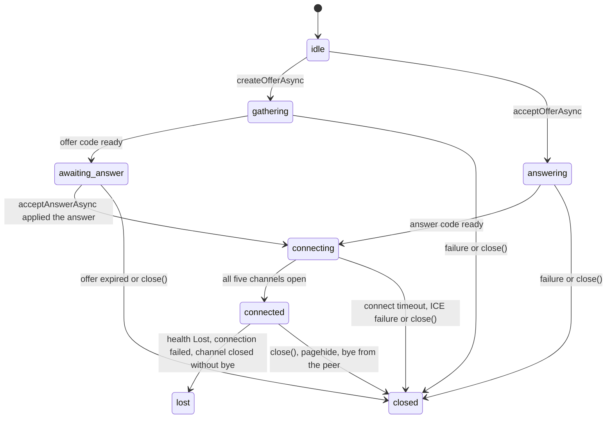

# Network

`src/network` is the low-level link of §17.2 in [Requirements](Requirements.md).  
It pairs two browsers with two codes, opens five negotiated data channels, moves JSON messages and binary frames,  
applies backpressure, and watches the link's health.  
It knows nothing about files, sessions, pages or storage (AR-02),  
and imports nothing from `src/client`, `src/media`, `src/platform`, `src/app` or `src/qr` (AR-01).

The contract is `networkTypes.ts`; `createNetwork(options)` and `inspectCode(codeOrUrl)` in `network.ts` implement it.

| Module | Holds |
| --- | --- |
| `network.ts` | `createNetwork`, `inspectCode`: pairing, channels, messages, frames, backpressure, health, stats, close |
| `networkTypes.ts` | The contract: `Network`, `NetworkOptions`, `NetworkEnvironment`, `NetworkError`, events |
| `browserEnvironment.ts` | The browser defaults for `NetworkEnvironment`; tests replace any member |
| `pairingCode.ts` | The compact code: binary layout, Base32, URL, candidate selection |
| `base32.ts` | RFC 4648 Base32 without padding, lenient when decoding pasted text |
| `address.ts` | IPv4, IPv6 and `.local` names to and from bytes |
| `sdp.ts` | Reads a local description, rebuilds a remote one from the template |
| `frame.ts` | The 16-byte frame header |
| `healthMonitor.ts` | Good, Weak and Lost from a clock, with no timers of its own |
| `checkCode.ts` | The 4-character check code from both fingerprints (SP-02) |
| `candidateStats.ts` | The candidate-pair table from `getStats()` (DL-06) |
| `fakeEnvironment.ts` | Test doubles: a clock, `RTCPeerConnection` and `RTCDataChannel` |

## Link states

One `Network` instance is one connection (AR-04).  
Once it is `lost` or `closed` it stays unusable,  
so a new pairing needs a new instance (HC-05).



The offerer passes `idle → gathering → awaiting-answer → connecting → connected`.  
The answerer passes `idle → answering → connecting → connected`:  
`answering` covers decoding the offer, the camera hook, building the answer and gathering,  
and `connecting` starts when the answer code is returned.

## Pairing

1. `createOfferAsync()` calls `exposeLocalIps()` (NW-06, HS-05), creates `new RTCPeerConnection({ iceServers: [] })`,  
   creates the five channels, then the offer (HS-01).  
   It waits for `iceGatheringState === 'complete'`, at most `timeouts.gatheringMs`, and uses whatever was gathered (HS-02).  
   The hook's stop runs as soon as gathering ends.  
   A denied or missing hook means `.local` names, and pairing continues.
2. The offer code is returned with its URL and `expiresAt`; after `timeouts.codeExpiryMs` an unanswered offer expires (HS-08).
3. `acceptOfferAsync(codeOrUrl)` rejects an offer older than `codeExpiryMs` plus 60 s of clock skew,  
   rebuilds the full offer description from the template below,  
   and returns the answer code, which carries the offer's tag.
4. `acceptAnswerAsync(codeOrUrl)` checks the answer's offer tag, rebuilds the answer description, applies it,  
   and resolves once all five channels are open.  
   A second answer gets `code-used`; an answer after expiry gets `code-expired`.  
   An answer made for another code gets `code-invalid`  
   ("This answer belongs to another code. Scan the answer shown for this code."),  
   and so does an answer the browser refuses; both leave the offer waiting for the right answer.

`inspectCode(codeOrUrl)` reads a code without a peer connection,  
so a tab that scanned an answer can forward it to the tab holding the offer (HS-07).  
It returns `{ kind, version, code, createdAt, candidateCount }`, with `createdAt` in epoch milliseconds,  
and throws `NetworkError` `code-invalid` or `code-version`.

### Connect timeout (HS-10)

The offerer fails with `connect-timeout` `timeouts.connectMs` after it applies the answer.  
The answerer cannot know when the offerer scans its answer, and copying a code by hand takes longer than 15 s,  
so it fails with `connect-timeout` `codeExpiryMs + connectMs` after its answer was created:  
the latest moment the offerer could still apply it and connect.

## The pairing code

The code is the bytes below, written as Base32 (RFC 4648 alphabet `A–Z 2–7`, no padding),  
so it fits QR alphanumeric mode once the URL part is split off.  
The QR holds `${appUrl}#${code}`; anything after the last `#` is the code.  
Decoding accepts the code alone or the whole URL, in any case, with spaces, dashes and `=` padding.

Integers are big-endian.

| Offset | Bytes | Field |
| --- | --- | --- |
| 0 | 1 | Magic and version: `0xE0 \| version`, so `0xE1` for version 1 |
| 1 | 1 | Flags: bit 0 kind (0 offer, 1 answer); bits 1–2 DTLS setup role (0 `actpass`, 1 `active`, 2 `passive`); bits 3–7 zero |
| 2 | 4 | Created at, seconds since the Unix epoch |
| 6 | 4 | `max-message-size`; 0 when the description had none |
| 10 | 1 | ICE ufrag length U, in characters (at least 4) |
| 11 | ⌈6U / 8⌉ | ICE ufrag, 6 bits per character |
| … | 1 | ICE pwd length P, in characters (at least 22) |
| … | ⌈6P / 8⌉ | ICE pwd, 6 bits per character |
| … | 1 | Fingerprint length F: 32, 48 or 64 |
| … | F | DTLS fingerprint; the length names the algorithm: SHA-256, SHA-384 or SHA-512 |
| … | 1 | mid length M (1–255) |
| … | M | mid, printable ASCII; never assumed to be `0` |
| … | 1 | Candidate count N (0–4) |
| … | N entries | Candidates, below |
| … | 2 | Answers only: the offer tag, the first 16 bits of SHA-256 over `ether-offer-tag-1`, the offer's fingerprint bytes and its ICE ufrag |

ICE credentials use the RFC 8839 `ice-char` set, exactly 64 characters,  
so each character takes 6 bits: `A–Z a–z 0–9 + /` map to 0–63, most significant bit first, the last byte zero-padded.

| Candidate type byte | Address | Bytes |
| --- | --- | --- |
| 1 | IPv4 | 4 |
| 2 | IPv6 | 16 |
| 3 | `.local` mDNS name | 16, the UUID of `<uuid>.local` |

Each entry is the type byte, the address, then a 2-byte port: 7 bytes for IPv4, 19 for IPv6 or mDNS.  
Only UDP host candidates of component 1 are carried, IPv4 first, then mDNS, then IPv6,  
each group by the browser's priority, without duplicates, at most four.  
Gathering that finds none fails with `gathering-timeout`: without a local socket nothing can connect.

Both sides compute the offer tag: the offerer from its own description when it makes the offer,  
the answerer from the offer code it decoded.  
The offerer refuses an answer whose tag is not its own before touching the peer connection,  
so an answer scanned from the wrong screen, or made for an older code, fails at once instead of after the connect timeout.

Typical sizes, with Chrome's 4-character ufrag and 24-character pwd:

| Candidates | Offer bytes | Offer characters | Answer bytes | Answer characters |
| --- | --- | --- | --- | --- |
| 2 IPv4 (camera granted) | 83 | 133 | 85 | 136 |
| 1 mDNS (no camera) | 88 | 141 | 90 | 144 |
| 2 mDNS | 107 | 172 | 109 | 175 |
| Firefox (8 + 32 hex characters), 2 IPv4 | 92 | 148 | 94 | 151 |

Decoding fails with `code-version` when the magic is right and the version is not 1,  
and with `code-invalid` for anything else: other characters, a wrong magic, unknown flags,  
short ICE credentials, a fingerprint length other than 32, 48 or 64, more than four candidates,  
an unknown candidate type, port 0, an answer without its offer tag, a cut-short code or bytes left over.

## The rebuilt description

The other side's description is rebuilt from this template, with standard lines only,  
so Chrome, Firefox and Safari accept it in any combination.

```
v=0
o=- <random 32-bit session id> 2 IN IP4 127.0.0.1
s=-
t=0 0
a=group:BUNDLE <mid>
m=application 9 UDP/DTLS/SCTP webrtc-datachannel
c=IN IP4 0.0.0.0
a=candidate:<n> 1 udp <priority> <address> <port> typ host     (one line per candidate)
a=end-of-candidates
a=ice-ufrag:<ufrag>
a=ice-pwd:<pwd>
a=fingerprint:<sha-256|sha-384|sha-512> <AB:CD:…>
a=setup:<actpass|active|passive>
a=mid:<mid>
a=sctp-port:5000
a=max-message-size:<n>                                         (only when the code has one)
```

Candidate `n` counts from 1 and its priority is the RFC 8445 host priority with a local preference  
that falls by one per candidate, so the order of the code is kept.  
Reading a local description takes `ice-ufrag`, `ice-pwd`, `setup`, `mid`, `max-message-size` and the fingerprint  
from the data section first and the session level second (Firefox writes the fingerprint at session level).

## Channels

All five are created before the offer or answer, negotiated with fixed ids, ordered and reliable,  
with `binaryType = 'arraybuffer'`, whatever `maxConcurrentFiles` is (NW-01, TR-03).

| Id | Label | `ChannelName` | Carries |
| --- | --- | --- | --- |
| 0 | `control` | `'control'` | JSON: the client's control messages, plus `ping`, `pong`, `vis` and `bye` |
| 1 | `slot1` | `1` | JSON and binary frames of the file in slot 1 |
| 2 | `slot2` | `2` | Slot 2 |
| 3 | `slot3` | `3` | Slot 3 |
| 4 | `slot4` | `4` | Slot 4 |

On every channel a string is a JSON message and an `ArrayBuffer` is a frame.  
Incoming JSON over 64 KiB, unparsable, or without a string `t` is dropped and logged (NW-03),  
as is binary data on `control`, a malformed frame, or a frame whose slot is not its channel's.

`send(channel, message)` throws `message-too-large` for JSON over 64 KiB or over `maxMessageSize`.  
`sendFrame(header, payload)` throws `message-too-large` when the header plus payload exceed `chunkSize`  
or `maxMessageSize` (NW-04).  
`maxMessageSize` is `pc.sctp.maxMessageSize`, or 64 KiB until it is known,  
and `maxFramePayload` is `min(chunkSize, maxMessageSize) − 16`.

## Frame header

16 bytes, big-endian, before the payload (TR-02).

| Offset | Bytes | Field |
| --- | --- | --- |
| 0 | 1 | Version, 1 |
| 1 | 1 | Slot, 1–4; must match the channel it arrives on |
| 2 | 2 | Flags, defined by the client |
| 4 | 4 | Page index |
| 8 | 4 | Offset in the page |
| 12 | 4 | Payload length; must equal the bytes after the header |
| 16 | n | Payload |

`encodeFrame` and `sendFrame` throw `RangeError` for a slot outside 1–4,  
a page or offset that is not a 32-bit unsigned integer, or flags above 16 bits: that is a bug in the caller.  
`decodeFrame` returns `undefined` for anything malformed, and the payload it returns is a view, not a copy.

## Backpressure (TR-04)

`maxBuffered` is shared by the active slots: those with bytes queued or a sender waiting.  
`waitDrainedAsync(slot)` resolves at once while the slot's `bufferedAmount` is within `maxBuffered / activeSlots`;  
otherwise it sets `bufferedAmountLowThreshold` to that share and resolves on `bufferedamountlow`.  
Every second the waiting senders are checked again, so a share that grows never leaves one waiting.  
A waiting sender gets `channel-closed` when the link ends.

## Health (§4)

| Message | Sent | Answer |
| --- | --- | --- |
| `{"t":"ping","seq":12,"ts":2051.3}` | On `control` every `timeouts.pingMs` once connected | `pong` with the same `seq` and `ts` |
| `{"t":"pong","seq":12,"ts":2051.3}` | In reply to a ping | Round-trip time = now − `ts` |
| `{"t":"vis","hidden":true}` | On every `visibilitychange`, and at connect if the page is hidden | — |
| `{"t":"bye","reason":"…"}` | On `close()`, on `pagehide`, and when the link is declared Lost | The peer closes at once |

The timestamp is `ts`, not `t`, because `t` is the message type of every envelope.  
These four never reach the client (NW-02).

- Any message from the peer, on any channel, is proof of life (HC-01).
- Health is checked every second: **Good** below `weakMs` of silence, **Weak** from `weakMs` to `lostMs`,  
  **Lost** above `lostMs`; never Weak in the first 5 s after connecting (HC-02).
- While the peer reports hidden, the timeout is suspended and the status stays Good;  
  it restarts from zero when the peer is visible again (HC-04).
- `connectionState` `disconnected` keeps waiting; `failed` or `closed` is Lost at once (HC-03).
- Lost is final: the network sends `bye` if it can, closes, and moves to `lost`.
- A channel that closes while connected without a `bye` first also means `lost`;  
  after a `bye` the state is `closed`.
- `health` events fire on each change of status, round-trip time or peer visibility.

## Errors

A failure that ends the link rejects the call that is waiting on it;  
with no call waiting, it is emitted as an `error` event instead, never both.

| Code | When |
| --- | --- |
| `code-invalid` | The text is not a code; an answer is given to `acceptOfferAsync` or an offer to `acceptAnswerAsync`; the answer's offer tag or mid is not this offer's; the browser refuses the rebuilt description; `acceptAnswerAsync` with no offer waiting |
| `code-version` | The code is from another version of the layout |
| `code-expired` | An offer older than `codeExpiryMs` + 60 s is accepted; an answer comes after the offer expired; emitted when an offer expires unanswered |
| `code-used` | A second answer for one offer; a second pairing call on one instance |
| `gathering-timeout` | Gathering ends, complete or at its cap, with no usable UDP host candidate |
| `connect-timeout` | Not connected in time (see Connect timeout) |
| `ice-failed` | ICE or the connection fails before connecting; a WebRTC call throws while pairing |
| `channel-closed` | `send`, `sendFrame` or `waitDrainedAsync` on a channel that is not open: before connecting, after `close()`, after Lost; a waiting `waitDrainedAsync` when the link ends; a channel that closes while connecting |
| `message-too-large` | See Channels (NW-04) |
| `send-failed` | The browser's `send()` throws, e.g. a full send queue |
| `closed` | A pairing call after the instance closed; a pairing call still running when `close()` is called |

`close()` (NW-07) sends `bye` when the control channel is open, stops every timer, interval and listener,  
closes the channels and the peer connection, and leaves the instance unusable.

## Logging (§16.6)

Everything goes through the injected `Logger`, in these categories:

- `pair`: camera permission result, offer and answer created, the `gathering` span, code size in bytes and characters,  
  code decoded, description rebuilt, signaling state, expiry, the `connect` span,  
  and on failure, at `error`, the last state every transport reached (DL-07).
- `ice`: each local candidate, each remote candidate from the code, peer-reflexive candidates,  
  and every gathering, ICE and connection state change.
- `pairs`: the candidate pairs from `getStats()` once connected or on failure; the selected pair at `info`.
- `dtls`: DTLS and SCTP state, fingerprint verified, each channel opening and closing, `maxMessageSize`, dropped messages.
- `health`: round-trip time at most every 10 s, each Good, Weak or Lost change, own and peer visibility, `bye`.

Neither the ICE password nor a whole code is ever put in a log message (SP-03, DL-14);  
data fields named like `icePwd`, `code` or `fingerprint` are redacted by the logger.

## Tests

`npx vitest run src/network` runs the unit tests.  
`network.test.ts` drives two instances through `fakeEnvironment.ts` with a fake clock:  
pairing, expiry, timeouts, messages, frames, backpressure, health, `bye` and close.

`npm run check:network` runs acceptance test 29 (NW-08) in a real Chromium:  
it bundles `scripts/checks/networkLoopbackPage.mjs` with esbuild, serves it on `http://127.0.0.1` at a free port,  
and drives it with `playwright-core`.  
Two instances in one page pair by passing their codes in code, once with the camera hook granted  
(Chromium's fake camera, so real IPv4 candidates) and once without it (`.local` names).  
Each scenario checks that both reach `connected`, that the check codes match,  
that control messages cross both ways with `ping` and `pong` kept inside,  
that 8 MiB cross each of the four slots in frames of the largest payload under backpressure,  
that oversized frames and JSON throw `message-too-large`,  
and that `close()` delivers `bye` and the other side closes at once.

The browser is the newest `chromium-*` under the `ms-playwright` cache, else an installed Chrome;  
set `CHROME_PATH` to choose another.  
Every step has a timeout, prints `PASS` or `FAIL`, and the script exits with 1 when any step fails.  
`--log` prints each scenario's network log, which reads as the handshake timeline.
