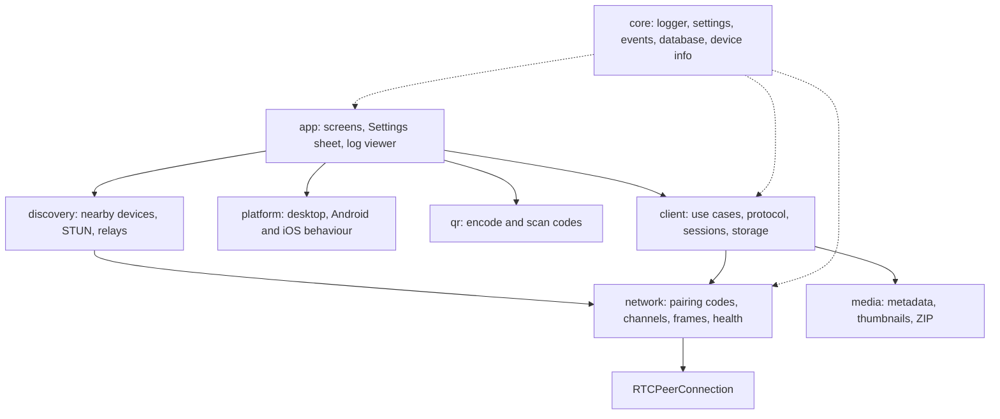

# Overview

Ether is a static web page that sends files directly between two browsers on the same Wi‑Fi over WebRTC.  
Devices pair with a tap on a nearby device, the default, or with a code: two QR scans, or copy and paste of the same codes.  
After the page has loaded, nothing talks to a server,
except [Nearby devices](Nearby.md), which lists the devices on the same network through STUN servers and relays
and sends a pairing request only to the one the user taps (the **Find nearby devices** setting).  
The requirements are in [Requirements](Requirements.md); IDs such as `HS-05` or `TR-06` refer to it.

- **Runtime:** Safari 17+, current Chrome, Edge and Samsung Internet, Firefox 126+; served from GitHub Pages over HTTPS
- **Source:** TypeScript (strict), no UI framework, SCSS, bundled by esbuild
- **Storage:** IndexedDB database `ether`
- **Tests:** Vitest, co-located `*.test.ts` files, logic on Node (`logic` project) and UI on happy-dom (`ui` project),
  plus browser checks in `scripts/checks` that pair two real Chromium pages

## Layers

Dependencies go one way (AR-01).  
`scripts/conventions.test.mjs` fails when the network imports the client, media, platform or UI code,
when discovery imports the client, media, QR or UI code,
when the client imports the UI or a platform, or when any code but the console sink calls `console`.

| Folder | Holds |
| --- | --- |
| `src/core` | Logger and sinks, settings schema, typed events, the IndexedDB schema, device detection |
| `src/platform` | The `Platform` interface and its desktop, Android and iOS implementations |
| `src/network` | `Network`: compact codes, SDP rebuilding, five negotiated channels, frames, backpressure, health, stats |
| `src/discovery` | `Discovery` ([Nearby](Nearby.md)): the public address from STUN, the room on Nostr relays, presence, pairing requests |
| `src/client` | `Client`: protocol, sessions, files and pages in IndexedDB, hashing, the scheduler, resume, batches, gallery |
| `src/media` | Metadata from EXIF, XMP, IPTC and QuickTime boxes, thumbnails, CRC-32 and store-only ZIP |
| `src/qr` | QR encoding with mixed segments, scanning with `BarcodeDetector` or jsQR |
| `src/app` | The page: shell, screens, Settings sheet, log viewer, gallery, styles and theme |
| `src/sw` | The service worker that precaches the build for offline use |

## Platforms

Behaviour that differs by device family sits behind `Platform` (`src/platform/platform.ts`).  
`createPlatform(info)` picks `IosPlatform` for iPhone and iPad, `AndroidPlatform` for Android,
and `DesktopPlatform` for everything else.  
Each overrides `BasePlatform` where its family differs:
picker buttons (§5), the camera and the hook that exposes local IPs (HS-05),
failure hints (HS-10), background behaviour (§10), install and storage warnings (§12), and setting defaults.

The family comes from the OS, never from the browser name.  
Inside each implementation, capability flags still decide which browser APIs are used,
so a phone without a camera pairs by Copy and Paste, and a browser without Wake Lock shows the "Keep this screen open" banner.

## Naming

- TypeScript files are camelCase and match what they export.
- Every function that returns a promise ends in `Async`, so the requirements' `createOffer()` is `createOfferAsync()`
  and `startPairing()` is `startPairingAsync()`.
- Internal identifiers keep the lowercase name (PW-00): database `ether`, `BroadcastChannel('ether')`,
  Web Lock `ether-connection`, storage keys `ether.*`.

## Build

`scripts/build.mjs` writes `dist`:

- `assets/main-<hash>.js` and its chunks, bundled and minified by esbuild, with linked source maps;
- `assets/styles-<hash>.css`, compiled from `src/app/styles.scss`;
- `index.html` from `src/app/index.html`, with the Content Security Policy as a meta tag (PW-04, SP-04);
- `sw.js`, with the list of every built file to precache and the build version as its cache name (PW-02);
- `manifest.webmanifest` and the icons from `public`.

Every path is relative, so the site works under `https://<user>.github.io/ether-web-app/`.
