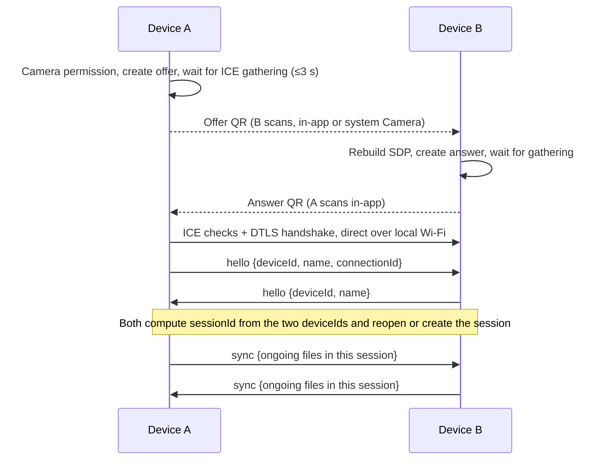
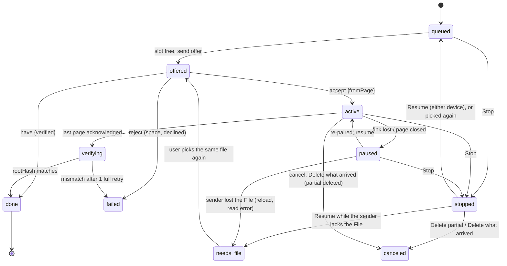
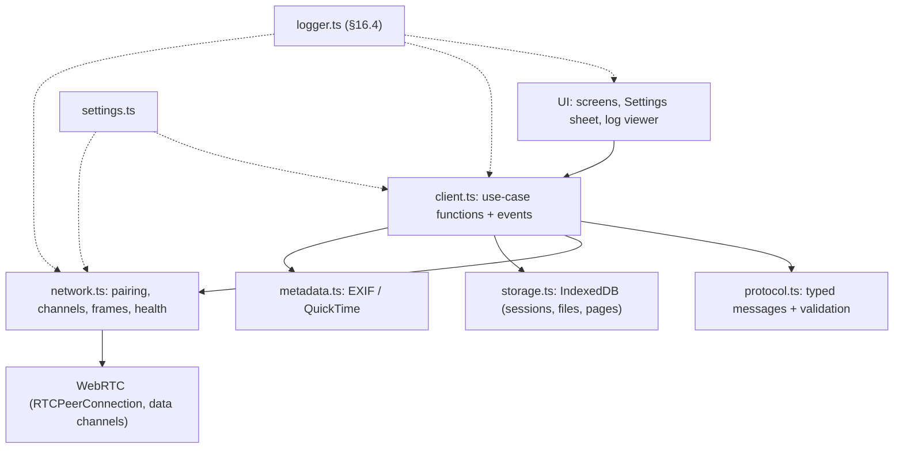

# Ether — Technical Requirements

**Name:** Ether, after the invisible medium Nikola Tesla believed carried energy without wires: files travel between devices through the air, with no wire and no server. Working name; check trademarks and domains before launch ("Ether" is also Ethereum's currency, which crowds search results), and avoid "Tesla" itself in the name (Tesla, Inc. trademark).

Serverless file transfer between browsers on the same Wi‑Fi · Draft · 23 Nov 2026

> **Implementation notes.** These record where the build follows or departs from the plan below.
>
> **Code.** Code follows `C:\Repos\DevToolbox\.claude\docs`, so TypeScript files are camelCase (`deviceInfo.ts`, not `device-info.ts`),
> and every function that returns a promise ends in `Async` (`createOfferAsync`, `startPairingAsync`).
> Behaviour that differs by device sits behind the `Platform` interface in `src/platform`, with desktop, Android and iOS implementations;
> capability flags still decide which browser APIs are used (see [Overview](Overview.md)).
>
> **Pairing.** Pairing is by QR code, or by copy and paste: every offer and answer QR has a **Copy code** button with the same code as text,
> so two devices without cameras pair through the clipboard. Codes carry local addresses only and the pairing connection uses no STUN or relay
> (`iceServers` stays empty), so pairing works on a Wi‑Fi with no internet. Codes expire after 5 minutes (1–30 in code, §16.2).
> With internet, **Find nearby devices** (an everyday setting, on by default) also lists the devices behind the same public IPv4 address,
> usually the same Wi‑Fi, departing from §1's "no servers at runtime": public STUN servers tell each device its public address,
> and small encrypted messages pass through Ether's own relay and public Nostr relays (see [Nearby](Nearby.md)).
> Tapping a device sends it this device's offer code; the other device shows the request for 60 seconds,
> and only when it accepts does its answer code come back, after which the devices connect exactly as with a QR code
> (directly, with the check code on both screens). Declining, or not answering, pairs nothing.
> A device may set a **PIN** (4 to 8 digits, SP-09 to SP-12): its nearby card then shows a PIN tag, the asker types the PIN,
> and a request that proves it connects without the Accept on that device. Pairing by code never asks for the PIN.
> With the setting off, or without internet, the app talks to no server, as §1 says.
>
> **Saving.** Received files always land in IndexedDB first (resume depends on it) and leave the app only as a ZIP download,
> which keeps each file's modified date as sent and, for photos and videos, the date taken as its created date
> (browsers never expose a file's real creation date). Every OS unzips natively, so no other way to save is offered
> and no unzip instructions are shown (this replaces the share, per-file download and folder routes of §9 and §18.4).
> A ZIP downloads only when the user asks for it, on every platform: batches accumulate in the app for as long as the user keeps sending,
> and the user selects files in Received (across batches) and taps **Download ZIP (N)**.
> Nothing is deleted automatically when a ZIP is downloaded: "Delete from app after saving" (RX-07, SV-07) is not offered,
> and received files leave the app's storage only when the user deletes them (a row, **Delete (N)** on a selection, Clear received or Clear all).
> Unfinished partials still expire after "Keep partial files", and history keeps entries without data for 7 days by default.
>
> **Screens.** The session has a peer bar across the top and three tabs: Send, Received and Sent; there is no separate Gallery tab.
> On wide screens the connected session takes the whole width, up to about 1,600 px.
> The session screen has no connection log, which departs from §7.6's "collapsible connection log per session".
> No banner warns about Safari deleting storage after 7 days without a visit (PW-07); installing is still offered.
> The Send tab shows the picker tiles when idle and the progress view while files move, on both devices:
> each batch is a header with its count and ⋯ over a flat list of its files, and one sticky Total progress card
> holds the bar, the counts, bytes, speed and time left, always shown, **Stop**, **Resume** and **Done** once stopped,
> and once finished **Send more** and **Done**.
> A batch that ran during the page's run stays there until Done, and so does a stopped one, also after a reload.
> A batch offered to this device is answered in a dialog, wherever the app is,
> and toasts are kept for outcomes the screen doesn't show (declined, copied, saved, cleared).
> Sent and Received group files by day, month (the default) or year and show them as a list or as thumbnails (tiles),
> both set with the type and status filters in one View & filter sheet; rows and tiles show a status only for exceptions.
> Their selection works both ways (GL-03): Select day, month or year and Unselect, Select all and Unselect all,
> and range clicks that select or unselect; Escape or the Select icon clears it.
> Picking is by the tiles of the Send tab only, with no tips on any device: drag and drop is not offered (PK-03),
> phones show Photos & videos and Files, and desktop shows Files and Folder.
> Touch screens can't be pinch- or double-tap-zoomed (viewport meta and `touch-action`, plus an iOS guard, since Safari ignores the meta),
> which departs from UI-08's 200% zoom on phones; text still follows the system text size.
>
> **Settings.** Settings is one sheet with the everyday settings only:
> device name (with name suggestions), a PIN, Find nearby devices, Ask before receiving (on by default), the theme (System, Light or Dark),
> storage with Clear all data, and the version.
> Every other setting in §16.2, the per-session overrides (AP-05), device info and the test tools have no UI:
> they stay in `src/core/settings.ts` and the client, and are changed in code.
> The log viewer opens only with `?debug=1`, which also turns debug logging on for that page.
> The screen always stays on while connected, pairing or transferring (WL-01), so there is no "Keep screen on while connected" setting.
> The send limits (page, chunk and buffer sizes, files at once) keep their §16.2 defaults, adjustable only in code; there is no automatic tuning.
>
> **Sending.** A file's identity (`fileId`) covers its content and its path, so identical files in different folders of one pick are both sent,
> while re-sending a file the other device already holds (same name and content, from any folder or an earlier send)
> is skipped once a full-hash check confirms it (a renamed file no longer matches its old partial, unlike §7.1).
> Running batches share the file slots fairly, so a batch picked while another is sending starts at once.
> **Stop** (the Total card, or a batch's Stop this batch) keeps what arrived, on both devices (TR-12):
> the files still moving or waiting rest as stopped, nothing moves again by itself, not even after re-pairing,
> and **Resume**, on either device, or picking the same file again, continues from the receiver's saved pages.
> Throwing a transfer away is separate and asks first: a file's Cancel or Delete partial, or a batch's **Delete what arrived**,
> deletes what arrived on both devices; there is no "Keep the partial file?" question (TR-09).
> Picking the same files again skips the finished ones and continues the unfinished ones.
> Every resume sends the receiver's last saved page again, and its new copy replaces the stored one (§7.4).
> Speed and time left (TR-10) come from the bytes actually crossing the link, sampled twice a second with a smoothed rate per file and per batch,
> so the estimate keeps moving between pages and on slow links, and says "Waiting for the connection…" while nothing moves.
> Thumbnails (TH-02) are paced by the control channel's buffer, not by a fixed rate,
> and are prepared two at a time ahead of the file data, so a large batch shows its thumbnails early (test 31).
>
> **Sessions.** Everything a connection holds in memory belongs to its session,
> so pairing with another device never shows or sends the previous device's files.
> When a re-paired device has a new identity (its site data was cleared, §7.5),
> the sender offers to move its unfinished files from the old session to the new one (**Send unfinished files to this device**);
> that is the only way files move between sessions.
> A peer that closes its page (`bye`, HC-06) turns the peer bar red with "Disconnected · 2 paused" and the re-pair actions,
> as a lost link does with "Connection lost · 2 paused", so a closed connection is never missed.

---

## 1. Scope and constraints

The app is a static web page that sends files directly between two browsers on the same Wi‑Fi. Once the page has loaded, it never contacts any server.

- **Hosting:** static files only (GitHub Pages). HTTPS is required, because the camera, Wake Lock, service worker and `crypto.subtle` only work on secure pages.
- **No servers at runtime:** no signaling server, no STUN, no TURN. The page talks only to its own origin, and only to load itself.
- **One build, no environments:** there is no dev/test/production split and no build flags. Every feature, including debug logging and test tools, ships to everyone; the everyday settings are switched in the Settings sheet, the rest in code (§16).
- **Transport:** WebRTC DataChannel (SCTP over DTLS over UDP).
- **Pairing:** an offer QR code and an answer QR code, with copy/paste of the same text as a fallback.
- **Recovery is a core requirement:** each pair of devices has a session that survives reconnects. Both devices track every file in it by file hash ID; files still in progress keep page-level pagination and can resume after any interruption (§7).
- **Impossible in a browser, so not required:** scanning the network, mDNS/Bonjour discovery, UDP broadcast, raw TCP sockets, Bluetooth or NFC on iPhone.
- **Out of scope:** transfers between different networks or over the internet (these need a TURN relay), and native apps.

---

## 2. Platform support

Target iOS 17+ and current Chrome on Android. On iPhone, every browser (Chrome, Edge, Firefox) uses Safari's engine, so iPhone limits apply to all of them ([source](https://eringen.substack.com/p/barcode-scanning-on-ios-the-missing)).

| Platform | Minimum | Why this minimum / known gaps |
| --- | --- | --- |
| iPhone, Safari tab | iOS 17 | iOS 17 added the photo picker's Options menu (location on/off, photo format). Keep-screen-on works from iOS 16.4. |
| iPhone, installed (home screen) | iOS 18.4 | Keep-screen-on was broken in installed web apps until iOS 18.4 ([web-features](https://web-platform-dx.github.io/web-features-explorer/features/screen-wake-lock)). |
| Android, Chrome | Last 2 stable versions | Photo picker strips GPS by default (§5). |
| Desktop Chrome / Edge | Last 2 stable versions | Usually no camera, so a paste-code fallback is required. |
| Desktop Firefox | 126+ | Keep-screen-on from 126. |
| Desktop Safari (Mac) | 17+ | No home-screen install, so stored data falls under Safari's storage rules (§12). |

- Detect each feature at runtime (`'wakeLock' in navigator`, `navigator.canShare`, `BarcodeDetector`, `navigator.locks`) and degrade; never branch on the browser name.
- Show one clear "not supported" screen when `RTCPeerConnection` or `indexedDB` is missing.

---

## 3. Pairing and handshake

Pairing takes two scans: device A shows an offer code, B scans it and shows an answer code, and A scans that. WebRTC leaves this exchange ("signaling") to the app ([MDN](https://developer.mozilla.org/docs/Web/API/WebRTC_API/Session_lifetime)), so the QR codes replace a server.



| ID | Requirement | Edge cases |
| --- | --- | --- |
| HS-01 | `new RTCPeerConnection({ iceServers: [] })`. Create the data channels (negotiated, fixed ids) before `createOffer()`. | Without a channel, the offer has no data section and cannot connect. |
| HS-02 | Don't send candidates one by one. Wait for `iceGatheringState === 'complete'`, with a 3 s cap, then encode. | Gathering can hang on some networks; use whatever was gathered at the cap. |
| HS-03 | Compact code: version, offer/answer flag, ICE username + password, DTLS fingerprint (32 bytes for SHA‑256), setup role, mid, up to 4 host addresses (IPv4 4 B, IPv6 16 B, `.local` UUID 16 B, port 2 B). The other side rebuilds a full SDP from a fixed template. | About 70–110 bytes. Support SHA‑384/512 fingerprints by length. Never assume mid is `0`; encode it. |
| HS-04 | Encode in Base32 (A–Z, 2–7): it fits QR "alphanumeric" mode and is URL-safe. The QR = app URL + `#` + code. Show the code in groups of 4 for copy/paste. | Accept lowercase, spaces and dashes when pasted. Reject a wrong version with a clear message. |
| HS-05 | Ask for camera permission *before* creating the offer and keep the camera on until gathering finishes. Browsers reveal real local IPs only to pages with camera/mic permission; otherwise they show a random `.local` name ([Chrome](https://groups.google.com/g/discuss-webrtc/c/6stQXi72BEU?pli=1), [Safari](https://bugs.webkit.org/show_bug.cgi?id=189503)). | Permission denied: continue with `.local` names. One side with a real IP is usually enough, because the other side learns the address from incoming checks. Both hidden and multicast blocked = failure; say so. |
| HS-06 | The offer QR also opens the app via the system Camera (URL with `#code`), and B then creates the answer automatically. | On iPhone, the system Camera opens Safari, even if the app is installed. Pairing still works, but B's identity and history are Safari's, not the installed app's (§11). |
| HS-07 | The answer must be scanned *inside* A's open page (the pending connection lives there). | A scans the answer with the system Camera: a new tab opens. Forward the code to the original tab with `BroadcastChannel`; if none answers, say "scan from inside the app". |
| HS-08 | Codes are single-use and expire after 5 minutes. | Old or reused code: "This code expired, show a new one." |
| HS-09 | Scanner: `BarcodeDetector` when present, a JS/WASM decoder otherwise. A paste box is always visible. | iPhone Safari has no `BarcodeDetector` (behind a flag) ([caniuse](https://caniuse.com/mdn-api_barcodedetector_barcodedetector)). Desktops often have no camera. |
| HS-10 | If not connected 15 s after the answer is applied, show a failure screen with likely causes. | See below. |

Causes the failure screen must cover:

- **Guest Wi‑Fi / client isolation:** the router blocks device-to-device traffic. Suggest the main network.
- **Not on the same network:** one phone on mobile data, or 2.4 GHz and 5 GHz set up as separate networks.
- **VPN on either device:** the VPN can hide or reroute the local network. Ask to turn it off.
- **Chrome "Local network" permission:** Chrome is adding a permission prompt for local network connections and is prototyping it for WebRTC ([intent](https://groups.google.com/a/chromium.org/g/blink-dev/c/CDy8LAs-DoA)). Expect a prompt; if denied, explain how to re-allow it in site settings.
- **Mixed browsers:** the rebuilt SDP must use only standard lines. Test Safari↔Chrome, Chrome↔Firefox and Safari↔Firefox.

---

## 4. Connection health

The app pings every 2 s on its own channel and calls the link lost after 10 s of silence while both pages are visible (both configurable, §16.2). Independently, browsers stop sending after 30 s without ICE consent replies ([RFC 7675](https://www.rfc-editor.org/rfc/rfc7675)).

| ID | Requirement | Edge cases |
| --- | --- | --- |
| HC-01 | Two channels: `control` (hello, sync, ping, names, bye) and `data` (files). | Both share one connection, so pings slow down under load. Count *any* received message (chunks, acks) as proof of life. |
| HC-02 | `ping {seq, t}` every 2 s; the reply echoes it. Show round-trip time. States: **Good** (<6 s since last message), **Weak** (6–10 s), **Lost** (>10 s). | Don't flag Weak during the first 5 s after connecting. |
| HC-03 | Also watch `connectionState`: `disconnected` = may recover, keep waiting; `failed` or `closed` = lost. | Lost pauses all transfers; it never deletes saved pages. |
| HC-04 | On `visibilitychange`, tell the peer `{hidden: true/false}`. The peer suspends its timeout while the other side is hidden. | Chrome runs timers in hidden tabs at most once per second, but an open data channel exempts the page from heavier throttling ([Chrome](https://developer.chrome.com/blog/timer-throttling-in-chrome-88)). On iPhone, WebRTC is suspended as soon as the screen locks or Safari goes to the background ([Apple forum](https://developer.apple.com/forums/thread/774239)). |
| HC-05 | No automatic reconnect of the WebRTC link: without a server, a dropped link needs a new pairing, with a code or through nearby devices. The peer bar's **Reconnect** starts that pairing through nearby devices: it asks the peer at once when it is listed, or waits for it to show up nearby and asks it then ([Screens](Screens.md#peer-bar)). After re-pairing with the same device ID, paused transfers resume by themselves (§7). | ICE restart also needs signaling, so it is not an option. Reconnect is a new pairing (a new offer, the peer's Accept or PIN, and the check code), never a restart of the old link. It needs Find nearby devices and the internet; the wait lasts for the page run until Cancel, a connection, the session being cleared or reset, or nearby search being turned off or going offline. |
| HC-06 | Send `bye` on Disconnect and on `pagehide`, so the other side reacts at once instead of after 10 s. | `pagehide` may not fire when iOS kills the page; the timeout still covers that. |
| HC-07 | One peer per page (one-to-one). | A third device scanning an old code is rejected (codes are single-use). |

---

## 5. Picking files and media

Offer two buttons, because the OS pickers behave differently and the photo pickers can silently change files. The app can't control these pickers; it can only choose which one opens and tell the user what to tap.

| ID | Requirement | Edge cases |
| --- | --- | --- |
| PK-01 | **Photos & videos:** `<input type="file" accept="image/*,video/*" multiple>`. | Opens the photo library on both platforms. |
| PK-02 | **Files:** `<input type="file" multiple>` with no `accept`. | On Android this opens the file browser, which keeps the original bytes. |
| PK-03 | Desktop: drag and drop onto the window, plus both buttons. Folder picking (`webkitdirectory`) on desktop; keep `webkitRelativePath` as the file's path. | iOS 18.4 improved `webkitdirectory` ([Safari 18.4 notes](https://developer.apple.com/documentation/safari-release-notes/safari-18_4-release-notes)); show it on iOS only if testing confirms it. |
| PK-04 | Never read a whole file into memory. Read with `file.slice()` per page. | Phone videos can be several GB. |
| PK-05 | If reading fails mid-transfer (`NotReadableError`), pause that file as `needs-file` and ask the user to pick it again. | The source was deleted, moved, or the OS dropped its temporary copy. |
| PK-06 | The same file picked twice (same file ID) is queued once. | Different names, same bytes = same file. |

**iPhone picker behaviour the UI must explain:**

- **Location:** since iOS 17 the photo picker has an Options menu that controls whether location is included ([WebKit](https://bugs.webkit.org/show_bug.cgi?id=257534)). Hint: "Tap Options → turn Location on".
- **Format:** the same menu has Format: Automatic, Current, Most Compatible. Automatic may convert HEIC to JPEG ([Apple forum](https://developer.apple.com/forums/thread/743037)). Hint: "Choose Current to send originals".
- **New photo from the camera:** taking a photo inside the picker strips GPS regardless of the setting ([WebKit](https://bugs.webkit.org/show_bug.cgi?id=263192)). Recommend taking photos in the Camera app first.
- **Videos:** a "Preparing…" step means iOS is converting the video ([Apple forum](https://developer.apple.com/forums/thread/736545)). Converted videos can arrive as a new temporary file with the original metadata lost ([Apple forum](https://developer.apple.com/forums/thread/693162)). Slo-mo and Cinematic effects are baked in.

**Android picker behaviour:**

- **Location:** the system Photo Picker removes GPS by default ([Android Authority](https://androidauthority.com/new-android-photo-picker-api-coming-3701717)). A newer picker API lets users choose to keep it ([Android Authority](https://androidauthority.com/android-photo-picker-location-sharing-release-3704689)); whether Chrome's file input uses it must be tested.
- **Workaround:** the Files button opens the file browser, which keeps EXIF location. Hint: "To keep location, use Files".

Never trust `File.lastModified` or the file name as the date a photo was taken; read it from the metadata (§8).

---

## 6. Transfer

Files move as numbered **pages** (the "batch"): the unit that is saved, hashed, acknowledged and resumed. Each page travels as several network chunks. Batch size, chunk size and the number of files sent at once are configurable.

**Transfer settings** (in code, §16.2; per session, with defaults for new sessions):

| Setting | Default | Range | Notes |
| --- | --- | --- | --- |
| `pageSize` (batch size) | 1 MiB | 256 KiB – 8 MiB | Bigger = fewer writes and acks, but more to redo after an interruption (at most one page per file). Fixed per file once it starts. |
| `chunkSize` | 64 KiB | 16 – 64 KiB | One `send()`. Never above `pc.sctp.maxMessageSize` ([MDN](https://developer.mozilla.org/docs/Web/API/RTCSctpTransport/maxMessageSize)); 64 KiB works across all three engines. |
| `maxConcurrentFiles` | Auto | Auto, 1 – 4, per direction | Each file in flight gets its own data channel. Auto = 2, or 4 when the batch's median file is under 5 MB (§18.1). |
| `maxBuffered` | 4 MiB | 1 – 16 MiB | Total unsent bytes across all channels (backpressure). |

The sender proposes `pageSize` in the `offer`; the receiver may lower it (low storage, slow device) in `accept`. The accepted value is stored in that file's pagination and used for every resume, even if settings change later.

| ID | Requirement | Edge cases |
| --- | --- | --- |
| TR-01 | Pagination exists per ongoing file only: `pageSize`, `totalPages = ceil(size / pageSize)`, `currentPage`, `pagesDone`. | Settings changes apply to files not yet started. |
| TR-02 | Chunk header (16 bytes): slot, page index, offset in page, flags. | A chunk for a page other than `currentPage` on that slot is dropped and logged. |
| TR-03 | Concurrency: channel id 0 = control; ids 1–4 = file slots, always pre-created by the network layer (§17.2) so concurrency can change without renegotiating. The client uses up to `maxConcurrentFiles` of them. A queued file takes the first free slot. Pages of one file stay in order on its slot. | Raising concurrency mid-session takes effect when slots free; lowering lets running files finish. More than 2 concurrent files on a phone raises memory and storage-write load; test before changing the default. |
| TR-04 | Backpressure: pause a slot when its `bufferedAmount` exceeds `maxBuffered / activeSlots`; continue on `bufferedamountlow`. | Filling the send buffer without limit can make `send()` throw and close the channel. |
| TR-05 | Message order per file: `offer` (manifest) → receiver `accept {fromPage, pageSize}` / `have {verified}` / `reject {reason}` → chunks → `page-end {page, sha256}` → receiver `ack {page}` → … → `file-end {rootHash}` → receiver `done {ok}`. On a resume `fromPage` is the receiver's last saved page, so that page is sent again (§7.4). | Every message carries `fileId`; a message for an unknown or finished file is ignored. A sender accepts a `fromPage` below the pages it has acknowledged and sends from there. |
| TR-06 | The receiver hashes each page, saves it, and only then sends `ack`. Hash mismatch → `nack {page}` → the sender resends that page, up to 3 times, then the file fails. | Duplicate page (already saved, same hash) → ack again, don't write; except the last saved page sent again on a resume, whose new copy replaces the stored one once it matches the sender's hash. |
| TR-07 | Before accepting, the receiver checks free space (`navigator.storage.estimate()`) and rejects with "needs X, has Y". | The estimate is approximate; a later `QuotaExceededError` pauses the file and keeps saved pages. |
| TR-08 | Queue in the order picked. A `needs-file` item doesn't hold a slot. | Hundreds of small photos: per-file overhead must stay small. |
| TR-09 | Cancel from either side: `cancel {fileId}`. Cancel, Delete partial and a batch's Delete what arrived delete what arrived on both devices; to keep it, Stop instead (TR-12). | Cancel during `verifying` still deletes cleanly. |
| TR-10 | Progress per file (page X of Y, %, speed, time left) and for the whole session, always shown: per file on the lines of files moving now, and for the session on the Total progress card, with no toggle. Receiver counts saved pages; sender counts acknowledged pages plus pages in flight. Redraw at most 10 times a second. | After a resume the counts start at the receiver's last saved page, one page below what was saved; a line keeps the furthest it showed, so its bar never goes backwards. |
| TR-11 | Zero-byte file: `totalPages = 0`, `offer` then straight to `file-end`. | Must still be recorded in the session. |
| TR-12 | Stop (a batch, from either device, `stop-batch`): its files still moving or waiting stop on both devices and keep what arrived: the receiver its saved, verified pages, the sender its page hashes and pagination. They move again only on **Resume** from either device (`resume-batch`), per file or per batch, or when the sender picks the file again; never by themselves, not even after re-pairing. | A device that missed the Stop (link down) stops the batch when the other's `sync` says so. A sender without the `File` (reload) asks for it on Resume. An older build ignores `stop-batch`, so the moving files are also paused for it with `cancel {reason: 'paused', keepPartial: true}`, and it keeps their pages. |

---

## 7. Sessions, history and resume (core)

A **session** belongs to one pair of devices and survives reconnects: pairing the same two devices again reopens the same session. Inside it, each device records every file it sent or received, indexed by **file hash ID**. Only files still in progress carry pagination; finished files keep a short record. **The receiver's saved pages decide where a file resumes**; the sender's pagination is a hint.

### 7.1 Identities

| Identity | How it's made | Used for |
| --- | --- | --- |
| `deviceId` | `crypto.randomUUID()` on first run, stored locally. Not a fingerprint. | Recognising the same device after re-pairing. |
| `sessionId` | SHA‑256 of the two `deviceId`s, sorted and joined; first 16 bytes as hex. Both devices compute the same value without negotiating. | Scope of all history, tracking and resume. Same pair = same session. |
| `connectionId` | Random, per pairing. | The session's connection log ("14:02–14:20, link lost"). |
| `fileId` (file hash ID) | SHA‑256 of: size (8 bytes) + first 64 KiB + 64 KiB from the middle + last 64 KiB; first 16 bytes as hex. Takes milliseconds, even for huge files. | Tracking files in the session, finding a file to resume, deduplicating. Content-based, so a renamed file still matches. |
| `pageHash[i]` | SHA‑256 of page *i*. | Verifying each page; resume check. |
| `prefixHash` | SHA‑256 over `pageHash[0..pagesDone)`. | Proving both sides agree on the saved part before resuming. |
| `rootHash` | SHA‑256 over all page hashes. | Final whole-file check, kept after the file finishes. |

Hashing per page is deliberate: `crypto.subtle.digest()` can't hash a stream; it needs the whole input in memory ([MDN](https://docs.w3cub.com/dom/subtlecrypto/digest)). Pages fit easily, so no extra hashing library is needed.

### 7.2 What each device stores (IndexedDB)

| Store | Key | Contents | On |
| --- | --- | --- | --- |
| `settings` | — | `deviceId`, device name, default transfer settings | Both |
| `sessions` | `sessionId` | Peer `deviceId`, peer name (last known), peer platform (`peerPlatform`, last known, when the peer sent one), created, last connected, connection log `[{connectionId, start, end, reason}]`, this session's transfer settings, totals (files and bytes sent / received) | Both |
| `files` | `[sessionId, fileId, direction]` | One record per file per direction in the session (below) | Both |
| `pages` | `[sessionId, fileId, pageIndex]` | Page `Blob` + hash. Exists only while the file is in progress, then until the user saves or deletes the file. | Receiver |
| `batches` | `[sessionId, batchId]` | Direction, item count, total bytes, counts received / saved / failed, created, finished | Both |
| `thumbs` | `[sessionId, fileId]` | Thumbnail JPEG (≤ 24 KiB), kept with history even after the file is deleted from the app (§18.2) | Both |

**`files` record — always present:** `fileId`, `direction` (`out` / `in`), `name`, `relativePath`, `size`, `mime`, `lastModified`, `metadata` (§8), `state` (7.3), `attempts`, `lastError`, `createdAt`, `updatedAt`, `completedAt`, `rootHash` (when done), `savedAt` (receiver: saved or shared out of the app).

**`pagination` — only while the file is in progress, deleted when it finishes:**

| Field | Example | Meaning |
| --- | --- | --- |
| `pageSize` | `1048576` | Batch size agreed for this file |
| `totalPages` | `2048` | Max pages |
| `currentPage` | `1312` | Next page to send or expect |
| `pagesDone` | `1312` | Receiver: saved and verified. Sender: acknowledged. Always contiguous from page 0. |
| `pageHashes` | 32 B × `pagesDone` | Kept on both sides |
| `prefixHash` | `e3b0c442…` | 7.1 |
| `slot` | `1` | Data channel while active; cleared when paused |
| `lastConnectionId` | `c-7f21…` | Connection it last moved in |

Ongoing (sender side):

```json
{
  "sessionId": "b41f9e0c2a7d4e11a0c3f5d6e7a8b9c0",
  "fileId": "7c1e09a4d2f34b5e8a9c0d1e2f3a4b5c",
  "direction": "out",
  "name": "IMG_2231.MOV",
  "size": 2147483648,
  "mime": "video/quicktime",
  "state": "paused",
  "pagination": {
    "pageSize": 1048576,
    "totalPages": 2048,
    "currentPage": 1312,
    "pagesDone": 1312,
    "prefixHash": "e3b0c44298fc1c149afbf4c8996fb924",
    "slot": null,
    "lastConnectionId": "c-7f21"
  },
  "updatedAt": "2026-11-23T14:20:11+01:00"
}
```

Finished (receiver side):

```json
{
  "sessionId": "b41f9e0c2a7d4e11a0c3f5d6e7a8b9c0",
  "fileId": "a90c55e1b2c34d5e6f708192a3b4c5d6",
  "direction": "in",
  "name": "IMG_2230.HEIC",
  "size": 3145728,
  "state": "done",
  "rootHash": "5d2c8e7f9a0b1c2d3e4f5a6b7c8d9e0f",
  "completedAt": "2026-11-23T14:05:42+01:00",
  "savedAt": null
}
```

**Write rules:**

- The receiver writes a page `Blob` and the updated pagination in **one IndexedDB transaction**, then sends `ack`. A crash mid-page loses only that page.
- The sender updates its pagination on each `ack` (at most once per second per file when pages are small).
- Any part-page in memory is discarded on interruption; only whole saved pages count.
- On `done`, delete `pagination` and keep `rootHash` and `completedAt`, in the same transaction that marks the file done.
- On a resume the last saved page is sent again: its stored copy stays until the new one, checked against the sender's hash,
  is written over it, so a page torn by a crash is healed and a link lost before it arrives loses nothing.

### 7.3 File states



`stopped` is the `paused` state with `pausedBy: 'stop'`, not a state of its own: a Stop on either device (TR-12).
It keeps what arrived on both devices like any pause, but only Resume or picking the file again moves it:
re-pairing, the peer's `sync` and a reload leave it stopped (a reloaded sender keeps it stopped until Resume, then asks for the `File`).

### 7.4 Resume after re-pairing

1. Both sides exchange `hello {deviceId, name, connectionId}`, compute `sessionId`, and reopen the session (or create it on first pairing).
2. Both sides send `sync`: their **ongoing** files in this session only — `fileId, direction, name, size, pageSize, totalPages, pagesDone, prefixHash, state`, and `held` or `stopped` for a file paused by the user or stopped. Finished files are not synced; duplicates are caught when an `offer` arrives (`have {verified}`).
3. For each file, the receiver's `pagesDone` and `prefixHash` win. Stopped files are left alone (TR-12); a batch stopped on one device while the link was down stops on the other here.
4. **Sender still has the `File`** (same page session): re-send `offer {resume: true}` → receiver `accept {fromPage: pagesDone − 1, pageSize, prefixHash}` (page 0 when nothing is saved), the prefix hash covering the pages before `fromPage` → sender compares with its stored page hashes → continues from that page. The receiver's last saved page goes again and its new copy, once it matches the sender's hash, replaces the stored one, so a page written as the link broke is never trusted blindly. Files resume independently, each in a free slot.
5. **Sender lost the `File`** (page reloaded): mark `needs-file` and show "Pick *IMG_2231.MOV* again to resume from page 1312 of 2048 (64%)". When the user picks files, compute their `fileId`s and match.
6. **Sender's site data was cleared** (new `deviceId`, so a new session): the user picks the file again. When its `offer` arrives, the receiver finds the partial from the old session by `fileId` + `size` and adopts it (7.5). The sender re-reads pages `0..pagesDone` once to check `prefixHash` ("Checking…"), then continues. The receiver keeps listing such partials under the old session so the user knows what to re-send.
7. **Receiver lost its data:** `accept {fromPage: 0}`; history shows "Partial data was lost, restarting".
8. **Stopped files** wait for Resume on either device, which tells the other with `resume-batch`, or for the sender to pick the file again,
   in any batch: either way the offer says `resumed`, and the receiver continues from its saved pages as in step 4 ("Resuming from 64%").
   A file already finished there is still skipped ("Skipped · already on *Pixel 8*").

### 7.5 Edge cases

| Case | Required behaviour |
| --- | --- |
| `ack` lost (page saved, sender didn't hear) | On resume the receiver's `pagesDone` wins: its last saved page is sent again and rewritten; an earlier page re-sent with the same hash is acked without writing. |
| Page closed or crashed mid-page | Only whole saved pages count (7.2 write rules). |
| Different file with the same `fileId` (very rare) | `prefixHash` mismatch → restart from page 0 and delete old pages. |
| Same file sent to two different devices | Two sessions, two separate records. |
| Same file again in the same session after it finished | Receiver answers `have {verified}` → sender shows "Already on Pixel 8"; offer "Send again". |
| Batch size changed mid-file | The file keeps its stored `pageSize`; new files use the new value. |
| Concurrency changed while files run | Applies as slots free; running files are never moved between slots. |
| Several files paused at once | Each resumes from its own pagination; order = original queue order. |
| `deviceId` changed (site data cleared) | New `sessionId`; the peer keeps the old session as a separate entry. When an `offer` arrives, the receiver also looks for a partial with the same `fileId` and `size` in *any* session; if `prefixHash` matches, it moves that pagination and its pages into the current session and resumes. |
| Two tabs of the app in one browser | Only one may hold the connection: take a lock with `navigator.locks`; the other tab shows "Open in another tab". |
| iPhone Safari tab vs installed app | Separate storage, so separate `deviceId` and sessions ([WebKit](https://bugs.webkit.org/show_bug.cgi?id=181849)). Tell iPhone users to always use the installed app. |
| Storage full mid-transfer | Pause with "Storage full"; keep saved pages. |
| Storage evicted (Safari) | Treated like "receiver lost its data" (step 7). Prevent with §12. |
| Old partials | Auto-delete partial received pages after 7 days (configurable), with a notice. |
| History size | Keep finished-file records for 7 days or 1,000 per session (configurable); "Clear session" and "Clear all". |

### 7.6 Session and history UI

History is kept but hidden: no device list on Home, and no sidebar of paired devices.

- **Previous sessions:** a drawer opened from the clock button in the header, one entry per session (= paired device),  
  last connected first, showing the peer name, its platform and last connected ("Android · Last connected Yesterday 20:07"),  
  a **Nearby** tag when the device is listed there, and a tag with the number of unfinished files.  
- **Nearby cards on Home** say **Paired before** for a device whose name a session's peer has,  
  with the number of that session's unfinished files.  
  Tapping an entry opens the connected session, connects through nearby when the device is nearby,  
  or says "*X* isn’t nearby" with **Pair with a code** and its files.  
  A bin clears that session on this device, after a confirmation; not the connected one.
- **Restore prompt:** connecting to a device whose session already holds files asks, on both devices,  
  "Restore your session with *X*?" with the last connection, the received, sent and unfinished counts,  
  and **Start fresh** or **Restore**. Transfers resume only when both chose Restore.  
  Start fresh from either side clears the session on both devices,  
  like Reset this device, canceling transfers in progress;  
  the other device closes its prompt and says "*X* started fresh. Your history with it was cleared."  
  A Start fresh made while the link is down reaches the peer at the next connection.  
  No prompt when the session holds no files, nor on a reconnect after link loss within the same page run (HC-05, CL-09).
- Inside a session: tabs **Send**, **Received**, **Sent**. The Send tab's lines show each file's size, state and bar with %,
  and a moving file's page X of Y, speed and time left.
- Row actions: Resume (or "Pick file again"), Cancel, Delete partial, Save / Share (received), Send again (sent).
- A collapsible connection log per session.

---

## 8. Metadata

Send the file bytes unchanged: that keeps EXIF and QuickTime metadata inside the file. Also send a metadata summary in the `offer` so the receiver can show it without parsing.

| ID | Requirement | Edge cases |
| --- | --- | --- |
| MD-01 | Never re-encode, resize or draw images to a canvas before sending. | Canvas export drops all metadata. |
| MD-02 | Summary fields: date taken (with time-zone offset if known), GPS (lat, lon, altitude), camera make/model, lens, width/height, orientation, duration, tags/keywords, title/description, rating, original name, relative path. | Missing fields are omitted, not null-filled. |
| MD-03 | Images (JPEG, HEIC, PNG, WebP): read EXIF, XMP and IPTC (e.g. with `exifr`). Tags from IPTC Keywords, XMP `dc:subject` and Windows XPKeywords. | Read only the needed byte ranges, not the whole file. |
| MD-04 | Videos (MP4/MOV): find the `moov` box by walking box headers (it may be at the end of the file). Read `mvhd` (created, seconds since 1904-01-01 UTC; duration), `tkhd` (size + rotation matrix), Apple keys `com.apple.quicktime.creationdate`, `…location.ISO6709`, `…make`, `…model`, and `©xyz` in `udta` (Android). | Fragmented MP4 and files without `moov` metadata → file-level fields only. |
| MD-05 | Date taken fallback: EXIF `DateTimeOriginal` → QuickTime `creationdate` → `mvhd` → `lastModified` (labelled "file date"). | |
| MD-06 | Extraction is limited to 2 s per file and never blocks sending; on failure, send without a summary. | |
| MD-07 | A file's Details sheet and the viewer show date taken, location (coordinates + "Open in Maps" link, opened only on tap), camera, length and tags. | No map tiles load automatically, so nothing leaves the LAN without a tap. |
| MD-08 | Sender shows a "Location included" badge on queued items that carry GPS. | Optional "Remove location" rewrites only the metadata block, never the pixels; it changes the `fileId`. |
| MD-09 | Audio (MP3, M4A, AAC, WAV, FLAC, Ogg, Opus, WebM audio and the like): the sender reads the length with an `<audio preload="metadata">` from an object URL, so the duration travels in the summary as a video's does. | Only where the sender's browser plays the format; a header without a length (`Infinity`, common in browser recordings) leaves it out. At most 1 s, inside MD-06's 2 s. |
| MD-10 | Every file has one category for its icon, its preview and the Type filter: photos, videos, audio, documents (PDF, Word, Excel, PowerPoint, OpenDocument, iWork, e-books, text, Markdown, CSV, RTF and the like), archives, and other files. The MIME type decides when it names a category, else the extension. | Photos and videos follow the stored kind, so a record's category never contradicts its thumbnail. |

---

## 9. Receiving and saving

Received files stay in app storage until the user saves or deletes them; history shows "Not saved yet" until then.

| ID | Requirement | Edge cases |
| --- | --- | --- |
| RX-01 | **Share…** button: `navigator.share({ files })` after checking `navigator.canShare`. Needs a tap. Many files at once: §18.4. | On iPhone, the "Save Image" option has gone missing in some versions ([WebKit](https://bugs.webkit.org/show_bug.cgi?id=255544)), and `share()` may never resolve after "Save Image" ([WebKit](https://bugs.webkit.org/show_bug.cgi?id=245854)). Don't wait on the promise; re-enable the button after 3 s. |
| RX-02 | **Download** button: `<a download>` with an object URL, always offered as well. | On iPhone this lands in Files → Downloads, not Photos. |
| RX-03 | Assemble the file as `new Blob(pageBlobs, {type})` from stored pages; never `arrayBuffer()` the whole file. | Multi-GB files on phones. |
| RX-04 | The saved file's date is the save time; a browser can't set it. The date taken stays inside the file, and photo apps use that. | Explain this once in Help. |
| RX-05 | Sanitise names (`/ \ : * ? " < > |`, control characters), keep the extension, add " (2)" on clashes. Flatten folder paths on mobile. | |
| RX-06 | Preview images, videos and audio with object URLs; revoke them after use. Show the category's icon if the browser can't decode or play the format (e.g. HEIC outside Safari, FLAC where the engine has no codec), and for every other kind of file. | A picture or player that fails after all gives way to the icon; nothing shows broken. |
| RX-07 | Setting "Delete from app after saving" (default on for phones). | Frees storage early. |

---

## 10. Keep screen on and background behaviour

| ID | Requirement | Edge cases |
| --- | --- | --- |
| WL-01 | Hold `navigator.wakeLock.request('screen')` while any transfer runs (either direction) and while a QR is shown. Release when idle. | Optional setting: "Keep screen on while connected". |
| WL-02 | Re-acquire on `visibilitychange` → visible; the browser releases the lock when the page is hidden. | |
| WL-03 | Support: Safari tab from 16.4; installed iPhone app from 18.4 ([Progressier](https://progressier.com/pwa-capabilities/screen-wake-lock)). Where missing, show a "Keep this screen open" banner. | No silent-video hacks. |
| WL-04 | iPhone suspends WebRTC when the screen locks or the app goes to the background. During a transfer, show "Keep the app open until done". | On return: if the link is lost → re-pair → resume (§7). |

---

## 11. Device names and identity

| ID | Requirement | Edge cases |
| --- | --- | --- |
| DN-01 | Default name = an adjective and a Greek hero or god ("Swift Perseus"), from public-domain myth. Browsers don't expose the real device name. The platform is not part of the name: it travels as its own field (DN-07). | A name saved on a device stays as it is. |
| DN-02 | Editable in Settings → Device name → Change: a rename sheet with the name, three suggestions in the default style and **More** for three others. 1–32 characters, trimmed, emoji allowed. Sent in `hello` and as `name` on change; peers store the last known name. | |
| DN-03 | Two peers with the same name: show the last 4 characters of `deviceId` after the name. | |
| DN-04 | `deviceId` changes if site data is cleared; that browser starts with no sessions. | The peer still has its partials; they are adopted into the new session on the next `offer` (§7.5). |
| DN-06 | Detect OS, device type, model, browser, engine and installed mode with `deviceInfo.ts` (user agent + Client Hints) for the platform, labels and diagnostics. Gate features only on its `capabilities` checks. | iPadOS sends a Mac user agent (touch points reveal it); Android's reduced user agent hides the model (Client Hints give it on Chromium only); every iPhone browser is WebKit. |
| DN-07 | Platform: Android, iPhone, iPad, Windows, Mac, Linux or ChromeOS, else Phone, Tablet or Computer by device type, picked by the `Platform` implementation. Sent as `platform` in the nearby `here` and in `hello`, and shown as a tag beside the name on nearby cards, the nearby request and the connected peer; sessions keep the peer's last one for the Previous sessions drawer. | Optional on receipt: a device on an older build sends none (its card shows its device type) and a value this build doesn't know is left out. |
| DN-05 | iPhone Safari and the installed app are two identities (separate storage, §7.5). | |

---

## 12. Installable web app, offline and storage

| ID | Requirement | Edge cases |
| --- | --- | --- |
| PW-00 | Internal identifiers use the lowercase name: IndexedDB database `ether`, `BroadcastChannel('ether')`, Web Lock `ether-connection`, storage keys `ether.*`, exported logs `ether-logs-<date>.json`. | Renaming the app later must not rename these, or existing history is lost. |
| PW-01 | Web app manifest: `name: "Ether"`, `short_name: "Ether"`, icons 192/512 + maskable, `display: standalone`, `start_url: "./"`, `scope: "./"`. Plus `apple-touch-icon` for iPhone. | |
| PW-02 | Service worker precaches every built file (hashed names, list generated at build). Cache-first. | After install, the app opens with no internet; the Wi‑Fi LAN is still needed. |
| PW-03 | New version: show "Update ready"; never reload during a transfer. | |
| PW-04 | GitHub Pages: all paths relative (served under `/repo/`); service worker scope = that folder. No custom headers are possible, so set a strict CSP with a `<meta>` tag. | |
| PW-05 | Install: Android → custom button via `beforeinstallprompt`; iPhone → instructions (Share → Add to Home Screen); there is no install prompt API on iPhone. | |
| PW-06 | Call `navigator.storage.persist()` at first transfer. | |
| PW-07 | Safari deletes script-written storage (IndexedDB included) after 7 days of Safari use without visiting the site; home-screen apps have their own day counter ([WebKit via M. Tsai](https://mjtsai.com/blog/2020/03/26/safari-13-1-third-party-cookie-blocking-and-7-day-script-writeable-storage/)). Recommend installing on iPhone; warn in the Safari tab when unfinished transfers exist. | |
| PW-08 | Quotas: when the limit is reached, writes fail with `QuotaExceededError`; from Safari 17, installed web apps get the same quota as the browser ([WebKit](https://webkit.org/?p=14403)). | Handled as "Storage full" (§7.5). |
| PW-09 | Optional later: store pages in the Origin Private File System where `createWritable()` exists (Safari added it in 26) ([WebKit bug](https://bugs.webkit.org/show_bug.cgi?id=231706)). | Keep IndexedDB as the baseline. |

---

## 13. Responsive UI (mobile portrait, mobile landscape, desktop)

Layout adapts to the available width and height, not to the device type. Use CSS container queries for components and media queries for the page shell.
Each screen holds its own buttons, and the header holds the brand (always Home), Previous sessions and Settings.

| Layout | When | Structure |
| --- | --- | --- |
| One column | Portrait screens under 900 px wide, and anything under 600 px wide | Home (who this device is, then the nearby devices), or the screen of the moment, alone. The session: peer bar on top, then the tabs. |
| Sidebar and pane | Width ≥ 900 px, or landscape and width ≥ 600 px, while not connected | On Home and while pairing with a code: a sidebar with who this device is and the nearby devices, beside a pane that offers pairing with a code on Home, or holds its steps. Landscape phones put the QR or camera beside the words of a step. |
| Connected | Any width, while connected | No sidebar: the session takes the whole width, up to about 1,600 px (peer bar across the top, the tabs and files below), and Home is one centred column. |

| ID | Requirement | Edge cases |
| --- | --- | --- |
| UI-01 | `viewport-fit=cover` + `env(safe-area-inset-*)` paddings. | In landscape the notch is on a side. |
| UI-02 | Use `100dvh`, not `100vh`. | Mobile browser bars change the height. |
| UI-03 | QR fills `min(width, height)` minus margins, at least 240 px, 4-module quiet zone, black on white even in dark mode. Hint "Turn up brightness" (a page can't set it). | |
| UI-04 | Camera view: rear camera on phones (`facingMode: 'environment'`), any camera on desktop; torch toggle where the track supports it. Survives rotation without restarting. | |
| UI-05 | Don't rely on orientation lock; every screen must work in both orientations, and rotating never loses state (mid-scan, mid-transfer). | |
| UI-06 | Touch targets ≥ 44×44 px; visible focus outlines; full keyboard use on desktop (Ctrl/Cmd+V pastes a code, Enter confirms). | |
| UI-07 | Mobile keyboard must not cover the code input: adjust with `visualViewport`. | |
| UI-08 | Dark mode (`prefers-color-scheme`), reduced motion, text sizes in `rem` and usable at 200% zoom; CSS logical properties. | |
| UI-09 | Long names: truncate in the middle, keep the extension; full name in details. | |
| UI-10 | Virtualise history lists above 200 rows. | |
| UI-11 | Every screen designed in all three layouts: empty, pairing (offer, scan, answer), connected, transferring, lost, error. | |
| UI-12 | Header: the brand on the left, which always goes Home; on the right **Previous sessions** (a clock) and the **Settings** button (a gear, §16), each 44×44 px with a tooltip. No peer pill: the peer's name and health show once, in the session's peer bar. The theme is chosen in Settings: **System** (the default; follows the system setting, also when it changes), **Light** or **Dark**, stored per device and applied as `data-theme` on `<html>`. | The QR stays black on white in every theme. On narrow portrait screens the button stays visible; other header items collapse first. |

---

## 14. Security and privacy

| ID | Requirement | Edge cases |
| --- | --- | --- |
| SP-01 | All traffic is DTLS-encrypted. The fingerprint in the QR means only the device that holds the matching key can complete the connection. | |
| SP-02 | After connecting, show a 4-character check code derived from both fingerprints on both screens. | Someone photographing the QR on the same network could race the real device; the check code exposes that. |
| SP-03 | Codes contain local IPs: single-use, 5-minute expiry, never logged. | |
| SP-04 | No third-party scripts, fonts or analytics. CSP: `default-src 'self'`; `img-src 'self' blob: data:`; `media-src blob:`. | |
| SP-05 | Validate every incoming message: known type, size limits (manifest ≤ 64 KiB, name ≤ 255 chars), page index < `totalPages`. Ignore unknown types. | |
| SP-06 | Never auto-open received files. Previews only for image, video and audio types the browser decodes or plays; audio and video play only on a tap. | |
| SP-07 | Setting "Ask before receiving", **on by default**: each batch waits for Accept on the receiving device; off, files from the paired device arrive without asking. | A device that stored Off keeps it. |
| SP-08 | Stored history and files are not encrypted at rest; offer "Clear all data". | |
| SP-09 | **PIN:** an optional everyday setting (`pin`), 4 to 8 digits, none by default. Set, changed and removed in the "Set a PIN" sheet from Settings; the field opens a numeric keypad (`inputmode="numeric" pattern="[0-9]*"`) and drops anything but digits. | It stays on the device: never sent to the peer or the room, never shown once saved, and redacted in logs and log exports. Clear all data keeps it, like the device name. |
| SP-10 | Nearby presence says `pin: true` when the device has a PIN; its card shows a 🔒 PIN tag. Connecting to it asks "Enter *X*'s PIN" first, and the request carries `proof` = HMAC-SHA256(key = PIN, message = requestId + "\|" + SHA-256(offer)), base64url, in its sealed box ([Nearby](Nearby.md#pin)). | A device without the tag that answers `pin-required` gets the same sheet; `wrong-pin` opens it again with "Wrong PIN. Try again." |
| SP-11 | A right proof connects straight away, with no Accept on the asked device (D1); a missing one is declined `pin-required`, a wrong one `wrong-pin`, without showing anything there. A device without a PIN asks as before. | Older builds still work together: an older asker sends no proof and reads `pin-required` as declined; an older device ignores the proof and shows its Accept dialog. |
| SP-12 | Guessing: after 5 wrong proofs within 10 minutes from one `nearbyId` or run, or 10 from all askers together, requests get `busy` for 60 s, and again for each further wrong proof in that window; logged without the PIN or who asked. Pairing by code (QR or paste) never asks for the PIN (D2). | A lockout answers the right PIN busy too, so it can't be used to test guesses. |

---

## 15. Acceptance tests

| # | Scenario | Pass criteria |
| --- | --- | --- |
| 1 | iPhone Safari ↔ Android Chrome, both scan in-app | Connected within 10 s of the second scan. |
| 2 | Camera permission denied on one side | Connects, or failure screen within 15 s with causes. |
| 3 | Offer scanned with iPhone system Camera | Answer appears automatically; A scans it in-app; connects. |
| 4 | Desktop without camera ↔ phone | Pairing by copy/paste works both ways. |
| 5 | Guest Wi‑Fi with client isolation | Failure screen names isolation within 15 s. |
| 6 | 50 photos iPhone → Android, Options → Location on | All verified (root hash match); GPS and date taken shown. |
| 7 | 2 GB video Android → iPhone; lock iPhone at 40% | Pauses; after unlock + re-pair, resumes from saved pages; final hash matches. |
| 8 | Close receiver page at 60%, reopen, re-pair | Resumes at its last saved page, which is written again; no other page is written twice. |
| 9 | Reload sender page at 30% | History shows "Pick file again"; re-picking resumes at 30%. |
| 10 | Sender clears site data at 50%, re-pairs, picks the file again | Receiver adopts the old partial; prefix check passes; resumes at 50%. |
| 11 | Receiver clears site data, re-pairs | Restarts from page 0 with a notice. |
| 12 | Same file sent twice | Second time shows "Already on <device>". |
| 13 | Both directions at once | Both verify; health never shows Lost. |
| 14 | Rotate phone mid-scan and mid-transfer | No state lost; layout correct. Desktop checked at 1280×800 and 1920×1080. |
| 15 | Receiver storage nearly full | Rejected before start with needed vs free. |
| 16 | Installed iPhone app (18.4+) and Safari tab (17) | Screen stays on during transfer. |
| 17 | Airplane mode + Wi‑Fi on, no internet, installed app | App loads and transfers. |
| 18 | Two tabs open | Second tab shows "Open in another tab". |
| 19 | Firefox desktop ↔ Safari iPhone; Chrome desktop ↔ Firefox Android | Pair and transfer. |
| 20 | Corrupt one page in transit (test hook) | `nack` → page resent → file verifies. |
| 21 | 20 files with `maxConcurrentFiles` = 1, 2 and 4; drop the link with 2 files mid-way | All verify; after re-pairing, both partial files resume from their own pages. |
| 22 | Change batch size while a file is running | That file keeps its page size; the next file uses the new one. |
| 23 | Re-pair the same two devices later | The same session reopens with its history; unfinished files are listed with page X of Y. |
| 24 | Debug logging on (console + memory) vs off during a 2 GB transfer | Speed differs by under 5%; page lines and per-second summaries appear live; off = no `getStats()` polling. |
| 25 | Pair with camera denied, debug logging on | Timeline shows `.local` candidates, a peer-reflexive pair and the selected pair; on failure, the last state reached is in red. |
| 26 | Log viewer (`?debug=1`) in portrait, landscape and desktop | It never covers the QR or camera; rotating keeps scroll position and filters. |
| 27 | Change batch size, concurrency and timeouts while connected | Each applies as its "Takes effect" column says; running files keep their page size. |
| 28 | Sinks: `none` only, then `console` only, then `memory` + `IndexedDB` | `none`: nothing in viewer or console. `console`: viewer empty. `memory` + `IndexedDB`: entries survive a reload as "Previous run". |
| 29 | Network loopback test: two `Network` instances in one page | Pair, exchange messages and frames on all 4 slots, close cleanly. |
| 30 | Client with fake network: drop the link mid-transfer, lose one `ack`, corrupt one page | Resumes from the last saved page, rewriting only that one, `nack` + resend; every file verifies. |
| 31 | 1,000 photos Android → iPhone | All thumbnails visible within 10 s; grid scrolls smoothly; Safari doesn't reload the tab; items save in groups of 50. |
| 32 | 3 GB selection saved as ZIP on iPhone | ZIP ready without a long wait (CRC precomputed); unzips in Files; select all → Save adds them to Photos with original dates. |
| 33 | Batch larger than free space | Prompt offers "Accept what fits"; accepted files complete, the rest are listed as declined. |
| 34 | Android receives 500 files, "Download all" | One permission prompt; all files in Downloads and visible in the gallery. |
| 35 | Stop a 5 GB send at 60%, lose the link, re-pair | Nothing moves until Resume; Resume on either device, or picking the file again, continues from the receiver's last saved page; Delete partial deletes it on both. |

---

## 16. Settings and logging

The **Settings** sheet holds the everyday settings: device name, PIN, Find nearby devices, Ask before receiving, the theme and storage.
Every other setting (batch size, timeouts, logging and the rest) has no UI: it stays centralized in `src/core/settings.ts`
(`SETTING_DESCRIPTORS`, the defaults and `normalizeSettings`) and is changed in code.
All code logs through one custom logger, which the settings route to nothing, the console, memory, storage or the peer.

### 16.1 Settings sheet

| ID | Requirement | Edge cases |
| --- | --- | --- |
| AP-01 | Opened from the Settings button (a gear) in the header (UI-12). Available at any time, connected or not. Rows, top to bottom: **Device name** (Change, DN-02), **PIN** (Set PIN, or Change and Remove, SP-09), **Find nearby devices**, **Ask before receiving**, **Theme** (System, Light or Dark), **Storage** (used · free, **Clear all data…**), then the app version. | Opening it during pairing or a transfer never interrupts them. A change made elsewhere (a rename, a system theme change) shows at once. |
| AP-02 | Layout: a bottom sheet on portrait phones, a centred sheet on landscape phones and desktop, with a close button beside the title; Escape and the backdrop close it too. | The sheet scrolls inside the safe area; the close button stays visible. |
| AP-03 | Changes apply immediately (no Save button), except the device name and the PIN, which their sheets save. | Values set in code are clamped by `normalizeSettings`; "Lost after" must be greater than "Weak after". |
| AP-04 | Every setting has a "takes effect" moment: now, next file, next pairing (table 16.2), kept with its descriptor in code. | |
| AP-05 | Stored in IndexedDB `settings` with a schema version and migrations. Transfer settings exist twice: defaults for new sessions, and (while connected) overrides for this session (§6), set in code through the client. | Settings never sync to the peer; batch size is negotiated per file (§6). |

### 16.2 Settings

| Section | Setting | Default | Range | Takes effect |
| --- | --- | --- | --- | --- |
| General | Device name | "Swift Perseus" (DN-01) | 1–32 characters | Now (sent to peer) |
| General | PIN | None | 4–8 digits | Now (never sent, SP-09) |
| General | Keep screen on while connected | Off | On / Off | Now |
| General | Ask before receiving | On (SP-07) | On / Off | Next file |
| General | Delete from app after saving | On for phones, Off for desktop | On / Off | Next save |
| Transfer | Batch (page) size | 1 MiB | 256 KiB – 8 MiB | Next file |
| Transfer | Chunk size | 64 KiB | 16 – 64 KiB | Next file |
| Transfer | Concurrent files | Auto (2; 4 for batches of small files) | Auto, 1 – 4 per direction | When a slot frees |
| Transfer | Send thumbnails first | On | On / Off | Next batch |
| Storage & history | Save to Photos group size | 50 | 10 – 100 | Now |
| Transfer | Max buffered | 4 MiB | 1 – 16 MiB | Now |
| Timeouts | Ping interval | 2 s | 1 – 10 s | Now |
| Timeouts | Weak after | 6 s | 3 – 30 s | Now |
| Timeouts | Lost after | 10 s | 5 – 60 s | Now |
| Timeouts | Gathering cap | 3 s | 1 – 10 s | Next pairing |
| Timeouts | Code expiry | 5 min | 1 – 30 min | Next pairing |
| Timeouts | Connect timeout | 15 s | 5 – 60 s | Next pairing |
| Timeouts | Offer reply (accept) timeout | 15 s | 5 – 60 s | Next file |
| Timeouts | Page ack timeout (then resend) | 10 s | 2 – 60 s | Now |
| Timeouts | Page resend tries | 3 | 1 – 10 | Now |
| Storage & history | Keep partial files | 7 days | 1 – 90 days | Now |
| Storage & history | Keep history | 7 days, 1,000 per session | 7 – 365 days, 100 – 10,000 | Now |
| Storage & history | Storage used / free | — | Read-only, in Settings | — |
| Storage & history | Clear all data… | — | Confirmation dialog, in Settings | Now |

Only Device name, PIN, Ask before receiving and Find nearby devices (`BASIC_SETTINGS`) appear in the Settings sheet;
every other row is changed in code.

### 16.3 Code-only settings and tools

These have no UI. They are set in `src/core/settings.ts` or through the client in code.

- **Debug logging:** master switch (off by default), minimum level (`debug` / `info` / `warn` / `error`), per-category levels (16.6), sinks: none / console / memory / IndexedDB / peer (multi-select). `?debug=1` turns debug logging on for that page without storing it.
- **Log viewer:** opened with `?debug=1` (16.5); buffer size (5,000), keep previous run (1,000 entries), export.
- **Connection stats:** `getStats()` polling interval (1 s; runs only while the viewer is open).
- **Show peer's logs** (DL-15).
- **Test tools:** simulate page corruption, drop the connection, fill storage, through `client.setTestTool` and `client.dropConnectionForTest`. A "Test tool active" banner shows until each is turned off.

### 16.4 Custom logger

| ID | Requirement | Edge cases |
| --- | --- | --- |
| LG-01 | One logger module. Every module logs through it at each important step; app code never calls `console.*` directly (lint rule `no-console`). | |
| LG-02 | API: `log.debug / info / warn / error(category, message, data?)`. `data` may be a function, called only if the entry is kept. `log.with({ sessionId, connectionId, fileId, page })` returns a child logger that adds that context. `log.span(category, name)` returns `end(data?)` and logs the duration (feeds the handshake timeline, DL-07). | |
| LG-03 | Routing comes from the settings, held in memory (no storage read per call). An entry passes when its level ≥ its category's level (or the global level); it then goes to every enabled sink. | |
| LG-04 | Sinks: **none** (drop), **console** (formatted, one colour per category), **memory** (ring buffer for the viewer), **IndexedDB** (previous run, written in batches once a second), **peer** (control channel, DL-15). | `none` with other sinks selected is ignored; `none` alone keeps nothing. |
| LG-05 | Settings changes reconfigure the logger live, without a reload. | |
| LG-06 | Cost of a filtered-out call: one level comparison and return; no string building, JSON or timestamps. | Hot paths (per page) still call the logger, so this must stay cheap. |
| LG-07 | Logging never throws and never awaits. Each sink is wrapped; a sink that fails is turned off and one warning is logged. | IndexedDB sink over its limit drops the oldest entries. |
| LG-08 | Redaction happens in the logger before any sink sees the entry (DL-14). | |
| LG-09 | Helpers for high-frequency events: `log.every(key, ms)` (sampling) and per-file aggregators for the per-second summaries (DL-09). | |
| LG-10 | Global `error` and `unhandledrejection` handlers log at `error` in category `app`. | |
| LG-11 | Defaults: memory sink, level `info` for `pair`, `ice`, `dtls`, `resume` and `app`, `warn` for the rest, console off. Turning on debug logging switches to `debug` for all categories with the sinks chosen in code. | So a failed handshake can be inspected afterwards even with debug logging off. |
| LG-12 | Tests inject a logger with only a memory sink and assert on entries (e.g. "resume fromPage=1312"). | |

### 16.5 Log viewer

| ID | Requirement | Edge cases |
| --- | --- | --- |
| DL-01 | Opened only with `?debug=1` in the URL (the `#` part is reserved for pairing codes), which also turns debug logging on for that page. It stays open beside the app, so you can watch a transfer. | Opening it mid-session shows everything already in the memory sink (LG-11), so the handshake is visible even if debug logging was off. |
| DL-02 | Panel placement: **portrait phone** = bottom drawer with a drag handle (default 40% height); **landscape phone** = right side panel, 50% width, over the instructions column (the QR or camera stays visible); **desktop** = docked right panel, resizable, default 380 px. | The panel never covers the QR or the camera view, and rotating keeps its scroll position and filters. |
| DL-03 | Monospace, 12 px, one line per entry, horizontal scroll instead of wrapping; tap or click a line to expand its JSON data. | Long IPv6 and `.local` names stay on one line. |
| DL-04 | Controls: filter by category and level, filter by file, text search, pause auto-scroll, clear, copy, download. | Auto-scroll pauses by itself when the user scrolls up. |
| DL-05 | Accessibility: the panel is a labelled region; no `aria-live` (it would flood screen readers). | |

### 16.6 What gets logged

Each entry: `{ t, wall, level, cat, msg, data, connectionId, sessionId, fileId?, page? }`. `t` is milliseconds since the pairing started (`performance.now()`), `wall` is local time.

| Category | Events |
| --- | --- |
| `device` | At startup: device detection result and capability flags (Appendix A), settings, storage estimate, `persist()` result. |
| `pair` | Camera permission result (it decides whether real IPs or `.local` names are exposed), offer/answer created, gathering start and end with duration, code size (bytes, characters, QR version), code decoded, SDP rebuilt, `signalingState` changes, expiry. |
| `ice` | Every local candidate (type, protocol, IP or `.local`, port), every remote candidate decoded from the code, peer-reflexive candidates learned, `iceGatheringState` / `iceConnectionState` / `connectionState` changes with timestamps. |
| `pairs` | Candidate-pair table from `pc.getStats()` (16.3). |
| `dtls` | DTLS state, fingerprint check result, SCTP state, `maxMessageSize`, each data channel opening or closing (id, label). |
| `health` | Ping round-trip time (sampled, see DL-07), Good/Weak/Lost changes, own and peer visibility changes, `bye`. |
| `resume` | `sync` sent and received, per-file decision (who wins, `fromPage`), `prefixHash` match or mismatch, partial adopted from another session. |
| `xfer` | Per file: offer, accept/have/reject, slot assigned, **one line per page** (page X of Y, ack time, hash prefix, buffered bytes), nack and retry, backpressure pause/resume, `file-end`, root hash result, cancel. |
| `store` | Page write time, transaction errors, `QuotaExceededError`, cleanup of old partials. |
| `wake` | Wake Lock acquired, released, re-acquired, unsupported. |
| `sw` | Service worker installed, update waiting, activated. |

### 16.7 Handshake and IP matching view

| ID | Requirement | Edge cases |
| --- | --- | --- |
| DL-06 | While the panel is open, poll `pc.getStats()` once a second and show a table: local candidate (type, IP or `.local`, port) ↔ remote candidate, pair state (waiting, in-progress, succeeded, failed), nominated, round-trip time, bytes sent/received. Highlight the selected pair. | Explain on screen: "`.local` = this browser hid its IP (no camera permission)"; "peer-reflexive = address learned from the other device's checks". |
| DL-07 | Handshake timeline summary at the top of the panel: camera permission → gathering → code shown → answer applied → ICE connected → DTLS connected → channels open, each with its duration. Failed steps are shown in red with the last state reached. | When pairing fails (HS-10) with `?debug=1`, the failure screen links to this timeline. |

Example:

```
+0.000  pair  info   camera permission: granted (real local IPs exposed)
+0.012  pair  info   offer created, gathering…
+0.214  ice   debug  local host udp 192.168.1.23:52344
+0.216  ice   debug  local host udp 10.84.2.7:61021
+0.301  pair  info   gathering complete 289 ms; code 86 B → 138 chars, QR v6
+9.880  pair  info   answer applied; remote host 192.168.1.41:60111, host 3f2a….local:60111
+9.902  pairs info   192.168.1.23:52344 ↔ 192.168.1.41:60111 in-progress
+9.951  pairs info   192.168.1.23:52344 ↔ 192.168.1.41:60111 succeeded, nominated, rtt 4 ms
+10.010 dtls  info   connected; fingerprint ok; sctp maxMessageSize 262144
+10.020 dtls  info   channels open: control, slot1, slot2
+10.031 resume info  peer sync: IMG_2231.MOV in, 1312/2048 pages, prefix match
+10.040 xfer  info   IMG_2231.MOV accept fromPage=1312 pageSize=1 MiB slot=1
+10.071 xfer  debug  IMG_2231.MOV page 1312/2048 ack 29 ms hash 9c1f… buf 1.9 MiB
+11.000 xfer  info   IMG_2231.MOV 1340/2048 (65.4%) 28.0 MiB/s, 25 s left
```

### 16.8 Batching, limits and export

| ID | Requirement | Edge cases |
| --- | --- | --- |
| DL-08 | The memory sink is a ring buffer of 5,000 entries (configurable). Show "N older entries dropped" when it wraps. | With debug logging off, only the default categories are kept (LG-11); page lines and stats polling start only when debug logging is on. |
| DL-09 | Never log per chunk. Per page: one line. Per active file: one summary line per second (pages, %, MiB/s, buffered, time left). Ping round-trip time: one line every 10 s, plus every Good/Weak/Lost change. | 4 files at once on a fast LAN can mean 100+ pages a second; the panel then keeps the per-second summaries and collapses page lines into "+87 pages". |
| DL-10 | Render in batches: queue entries and append them to the panel once per animation frame (at most 10 times a second); virtualise the list. | Logging must never slow a transfer; measure transfer speed with the panel open and closed (test 24). |
| DL-11 | Debug logging off = filtered-out calls return immediately (LG-06), `getStats()` polling stops, and a closed viewer is removed from the DOM. | |
| DL-12 | The IndexedDB sink keeps the last 1,000 entries of the previous page load, viewable as "Previous run", to debug after a crash or reload. | Cleared with "Clear all data". |
| DL-13 | Export: copy to clipboard or download as `.txt` or `.json`, including device info and settings. Nothing is uploaded anywhere. | |
| DL-14 | Redaction: never log the ICE password, full pairing codes, the PIN or a PIN proof (the export's settings too); show only the first 8 characters of fingerprints and hashes. IPs are shown in the panel; an export option masks them (`192.168.1.x`). | Logs can be shared in bug reports; masking keeps local network layout private. |
| DL-15 | Optional: "Show peer's logs" — when both devices turn it on in code, the peer's logger (peer sink) streams its `pair`, `ice`, `pairs` and `resume` entries over the control channel; shown with a peer label. | Handshake entries from before the connection are sent from the peer's buffer once the channel opens. |

---

## 17. Code architecture: network and client layers

Two TypeScript modules with a strict boundary. `network.ts` is the low level: it pairs two browsers and moves messages and bytes between them. `client.ts` sits on top and offers one ready-made function per use case (pair, send files, resume, cancel…). The UI calls only the client.



### 17.1 Layer rules

| ID | Requirement |
| --- | --- |
| AR-01 | Dependencies go one way: UI → client → network. The network never imports client, storage, metadata or UI code. |
| AR-02 | The network knows nothing about files, sessions, pages or storage. The client knows nothing about SDP, ICE, channel ids or frame headers. The UI knows only the client's functions, events and types. |
| AR-03 | Logger and settings are injected into both layers (no globals), so tests can swap them. |
| AR-04 | One `Network` instance = one connection. A new pairing creates a new instance; the client keeps its state and attaches the new one (CL-09). |
| AR-05 | No framework in either layer: plain TypeScript, `strict` mode, usable from any UI. |

### 17.2 `network.ts` (low level)

What it does: QR code handshake (§3), the compact code format, data channels, frame header encoding, backpressure, ping/pong health (§4), connection stats, close.

```ts
export type LinkState =
  | 'idle' | 'gathering' | 'awaiting-answer' | 'answering' | 'connecting' | 'connected' | 'lost' | 'closed';

export interface Health { status: 'good' | 'weak' | 'lost'; rttMs?: number; lastSeenMs: number; peerHidden: boolean }

export interface Message { t: string; id?: string; re?: string; [key: string]: unknown } // JSON envelope

export interface FrameHeader { slot: number; page: number; offset: number; flags: number } // 16 bytes on the wire

export interface NetworkOptions {
  chunkSize: number; maxBuffered: number;
  timeouts: { gatheringMs: number; codeExpiryMs: number; connectMs: number; pingMs: number; weakMs: number; lostMs: number };
  exposeLocalIps?: () => Promise<(() => void) | null>; // e.g. open the camera; returns "stop"
  logger: Logger;
}

export interface Network {
  // Pairing
  createOffer(): Promise<{ code: string; url: string; expiresAt: number }>;
  acceptOffer(codeOrUrl: string): Promise<{ code: string; url: string }>; // returns the answer
  acceptAnswer(codeOrUrl: string): Promise<void>;                          // resolves when connected
  // Messaging
  send(channel: 'control' | 1 | 2 | 3 | 4, msg: Message): void;
  sendFrame(header: FrameHeader, payload: Uint8Array): void;
  drained(slot: 1 | 2 | 3 | 4): Promise<void>; // resolves when the slot is below its buffer share
  // State
  readonly state: LinkState;
  readonly health: Health;
  readonly maxMessageSize: number;
  stats(): Promise<CandidatePairStats[]>;      // for the log viewer (§16.7)
  configure(options: Partial<NetworkOptions>): void; // live changes to the settings
  close(reason?: string): void;                // sends bye
  on<E extends keyof NetworkEvents>(event: E, handler: NetworkEvents[E]): () => void; // returns unsubscribe
}

export interface NetworkEvents {
  state(state: LinkState): void;
  health(health: Health): void;
  message(channel: 'control' | 1 | 2 | 3 | 4, msg: Message): void;
  frame(header: FrameHeader, payload: Uint8Array): void;
  error(error: NetworkError): void;
}

export type NetworkErrorCode =
  | 'code-invalid' | 'code-expired' | 'code-version' | 'gathering-timeout' | 'connect-timeout'
  | 'ice-failed' | 'channel-closed' | 'message-too-large' | 'send-failed';
```

| ID | Requirement | Edge cases |
| --- | --- | --- |
| NW-01 | Always pre-create channel 0 (control) and slots 1–4 (negotiated ids), whatever `maxConcurrentFiles` is. | Unused slots cost almost nothing; changing concurrency never needs a new pairing. |
| NW-02 | Handles `ping`, `pong`, `vis` (visibility) and `bye` itself; they never reach the client. | |
| NW-03 | Incoming JSON: drop and log anything over 64 KiB, unparsable, or without a string `t`. | |
| NW-04 | `sendFrame` throws `message-too-large` if header + payload exceed `chunkSize` or `maxMessageSize`. | |
| NW-05 | Sending on a closed channel throws `channel-closed`; nothing is dropped silently. The client decides what to do. | |
| NW-06 | Calls `exposeLocalIps()` before gathering and its "stop" after (HS-05), so camera handling stays outside the network layer. | Hook missing or denied → continue with `.local` candidates. |
| NW-07 | `close()` stops all timers and listeners, sends `bye` if possible, and leaves the instance unusable. | |
| NW-08 | Testable in one page: two instances paired by passing codes in code (loopback), no camera needed. | |

### 17.3 `client.ts` (messaging and use cases)

What it does: typed protocol (`protocol.ts`), requests with replies and timeouts, sessions and history (§7), file queue and slot scheduling, pagination, resume, verification, storage through `storage.ts`, metadata through `metadata.ts`, and events for the UI.

**Ready-made functions:**

| Use case | Function | Returns / effect |
| --- | --- | --- |
| Start pairing (device A) | `startPairing()` | `{ code, url, expiresAt }` to show as QR |
| Join (device B) | `joinWithCode(codeOrUrl)` | `{ answerCode, answerUrl }` to show as QR |
| Finish pairing (device A) | `completePairing(answerCodeOrUrl)` | `Peer` once connected; then hello + sync run by themselves |
| Cancel pairing | `cancelPairing()` | Discards the pending offer |
| Disconnect | `disconnect()` | Sends `bye`; pauses running files |
| Rename this device | `rename(name)` | Saves it and tells the peer |
| Send files | `sendFiles(files, { relativePaths? })` | `Batch` (id + `FileHandle[]`), queued; thumbnails, IDs and metadata prepared in the background (§18) |
| Pause / resume one file | `pause(fileId)`, `resume(fileId)` | State change; resume takes the next free slot |
| Cancel one file | `cancel(fileId, { keepPartial })` | Both sides notified |
| Stop / resume a batch | `stopBatch(batchId)`, `resumeBatch(batchId)` | Keeps what arrived on both sides; Resume continues from the receiver's saved pages (TR-12) |
| Delete what arrived of a batch | `cancelBatch(batchId)` | Cancels its unfinished files and deletes their partials on both sides |
| Resume after reload | `resumeWithFiles(files)` | Matches re-picked files to `needs-file` items by `fileId`; returns `{ matched, unmatched }` |
| Send a finished file again | `sendAgain(fileId)` | Skips the "already received" check |
| Accept / reject incoming | `acceptIncoming(fileId)`, `rejectIncoming(fileId, reason)` | Used when "Ask before receiving" is on |
| Get a received file | `getReceivedFile(fileId)` | `File` assembled from stored pages (the UI downloads or shares it) |
| Gallery | `listGallery({ sessionId, batchId?, filter, groupBy: 'day' })`, `getThumbnail(fileId)` | Rows for the virtualised grid (§18.3); thumbnail `Blob` |
| Accept a batch | `acceptBatch(batchId, { mode: 'all' \| 'fits' })`, `declineBatch(batchId)` | Answers the batch prompt (§18.1) |
| Bulk save | `buildZip(fileIds)`, `saveToFolder(fileIds, dirHandle)` | Store-only ZIP `Blob` (§18.4); direct folder write on desktop Chrome/Edge |
| Mark as saved / delete | `markSaved(fileId)`, `deleteReceived(fileId)` | Updates `savedAt`; frees storage |
| Delete a partial | `deletePartial(fileId)` | Removes pages and pagination, on both sides while connected |
| History | `listSessions()`, `getSession(id)`, `listFiles({ sessionId, direction, state })` | Plain data for the UI |
| Clear | `clearSession(id)`, `clearAll()` | Confirmed by the UI first |
| Settings | `configure(partialSettings)` | Applies live (to itself and the network) per §16.2 |
| Diagnostics | `getDiagnostics()` | Link state, health, candidate pairs, slots, buffers |
| Peer logs | `setPeerLogs(on)` | §16.8 DL-15 |

**Events:** `state` (pairing/connection), `peer` (connected, renamed, left), `health`, `batch-incoming` (count, size, free space), `batch-progress`, `thumb`, `file-queued`, `file-incoming` (waiting for accept), `progress` (fileId, page X of Y, bytes, speed, time left), `file-state`, `file-done` (verified), `file-failed`, `needs-file`, `sync` (resume decisions), `error`.

| ID | Requirement | Edge cases |
| --- | --- | --- |
| CL-01 | All messages are a typed union in `protocol.ts` (table below). `hello` carries the protocol version; a different major version stops with "Update the app on *Pixel 8*". | |
| CL-02 | Messages that need a reply carry `id`; the reply carries `re`. Each type has a timeout from settings (offer → accept 15 s, page → ack 10 s); on timeout: retry per settings, then fail the file. | Late replies after a timeout are ignored. |
| CL-03 | Every incoming message is validated (types, sizes, ranges, known `fileId`) before acting (SP-05). | Invalid → logged and dropped; repeated invalid messages → disconnect. |
| CL-04 | All persistence goes through `storage.ts`, following the transaction rules in §7.2. | |
| CL-05 | Scheduler: FIFO queue, one file per slot, up to `maxConcurrentFiles`. | Lowering concurrency lets running files finish. |
| CL-06 | Functions are safe to call twice: `resume` on an active file, `cancel` on a finished one, etc. are no-ops. | |
| CL-07 | Failed calls reject with `ClientError { code, message, fileId? }`; the UI maps `code` to text. | |
| CL-08 | `progress` events at most 10 per second per file; with many files, batched into one event per frame. | |
| CL-09 | When the link drops, the client keeps queue and state. After a new pairing it attaches the new `Network`, runs `hello` + `sync`, and resumes (§7.4) without UI involvement. | |
| CL-10 | Testable with a fake network: an in-memory pair with adjustable delay, loss and disconnects (tests for resume, `nack`, concurrency). | |

**Protocol messages:**

| Channel | Type | Direction | Fields | Reply |
| --- | --- | --- | --- | --- |
| control | `hello` | both | `protocol`, `deviceId`, `name`, `connectionId` | — |
| control | `sync` | both | ongoing files: `fileId`, `direction`, `name`, `size`, `pageSize`, `totalPages`, `pagesDone`, `prefixHash`, `state` | — |
| control | `name` | both | `name` | — |
| control | `log` | both | `entries[]` (peer logs) | — |
| slot | `offer` | sender → receiver | manifest: `fileId`, `name`, `size`, `mime`, `lastModified`, `relativePath`, `pageSize`, `totalPages`, `metadata`, `resume?` | `accept` / `have` / `reject` |
| slot | `accept` | receiver → sender | `fromPage`, `pageSize`, `prefixHash` | — |
| slot | `have` | receiver → sender | `verified` | — |
| slot | `reject` | receiver → sender | `reason` (`space`, `declined`, `invalid`) | — |
| slot | `page-end` | sender → receiver | `page`, `sha256` | `ack` / `nack` |
| slot | `ack` / `nack` | receiver → sender | `page` | — |
| slot | `file-end` | sender → receiver | `rootHash` | `done` |
| slot | `done` | receiver → sender | `ok` | — |
| slot | `offer-batch` | sender → receiver | `batchId`, `index`, `last`, `files[]` (manifests as in `offer`); split so each message stays under 60 KiB | `batch-reply` |
| slot | `batch-reply` | receiver → sender | `batchId`, per file: `accept {fromPage}` / `have` / `reject {reason}` | — |
| control | `thumb` | sender → receiver | `fileId`, `jpeg` (base64, ≤ 32 KiB) | — |
| slot | `cancel` | both | `keepPartial` | — |
| slot | binary frame | sender → receiver | 16-byte header + chunk bytes | — |

`ping`, `pong`, `vis` and `bye` belong to the network layer (NW-02) and are not part of this table.

---

## 18. Bulk transfers and gallery

Thousands of files per transfer are supported. They are offered in batches, received into app storage, shown in a virtualised gallery built from small thumbnails, and saved to Photos in groups. Rough sizing: 1,000 photos × 3 MB ≈ 3 GB, which takes about 2.5 min at 20 MB/s or 10 min at 5 MB/s, with the screen kept on throughout.

### 18.1 Batches

| ID | Requirement | Edge cases |
| --- | --- | --- |
| BK-01 | One selection = one batch (`batchId`), shown on the Send tab as a header with its count over the list of its files; the Total progress card shows items received / saved / failed / stopped, bytes, speed, time left, with **Stop**, or **Resume** and **Done** once everything shown is stopped. | Files added while a batch runs form a new batch. A stopped file picked again moves to the new batch and continues there; its old batch counts one file less. |
| BK-02 | Batches are offered with `offer-batch` (manifests split into messages under 60 KiB, about 200 files each) and answered once with `batch-reply` (per file: accept from page N, already have, reject). Single files still use `offer`. | Resume and duplicate checks for thousands of files take one round trip per message, not per file. |
| BK-03 | Receiver dialog: "Pixel 8 wants to send you 1,240 items", "3.8 GB · Free: 21 GB." Decline / Accept. When it doesn’t all fit: Decline / "Accept what fits (N)" (first N files in order) / Accept all. | Saved-to-Photos copies use space too until deleted from the app; warn when free space is under 1.1 × the batch size. |
| BK-04 | Picking on phones: suggest a few hundred items at a time. The iOS picker may take a while before it returns (it converts items first); the app shows nothing until it does. | Desktop: folder picking (PK-03). |
| BK-05 | Concurrency Auto: 4 slots when the batch's median file is under 5 MB, otherwise 2 (unless set manually). | |
| BK-06 | File IDs, metadata and thumbnails are prepared at most 2 files at a time, just ahead of sending, never for the whole batch up front. | Keeps memory flat for 5,000-item batches. |
| BK-07 | "Retry failed only" per batch; everything else resumes per file (§7). The batch ⋯ holds **Stop this batch** while it moves and **Resume this batch** once stopped, both keeping what arrived, and **Delete what arrived**, which asks first and deletes it on both devices. | |

### 18.2 Thumbnails

| ID | Requirement | Edge cases |
| --- | --- | --- |
| TH-01 | The sender makes one thumbnail per photo or video: longest side 256 px, JPEG about quality 0.7, at most 24 KiB. Photos: the preview already embedded in the file (`exifr.thumbnail()`), else decode with `createImageBitmap` and draw to a canvas. Videos: seek a `<video>` to 1 s and draw that frame. | Apply the EXIF orientation to embedded previews. A format the browser can't decode, or a video it can't play: no thumbnail, show its category's icon (GL-08). |
| TH-02 | Thumbnails travel as `thumb` messages on the control channel, ahead of file data, at most 10 per second, paused when the control channel has over 256 KiB queued. | Must never delay pings (§4). |
| TH-03 | The receiver stores them in `thumbs` (§7.2) and keeps them in history after the file itself is deleted. | 1,000 thumbnails ≈ 20 MB. |
| TH-04 | "Send thumbnails first" can be turned off in code (§16.2); the receiver then makes its own after each file arrives. | |

### 18.3 Gallery

| ID | Requirement | Edge cases |
| --- | --- | --- |
| GL-01 | Virtualised grid: only visible rows plus one screen above and below exist in the page (about 60 cells). Columns by width (cells ≥ 80 px): about 4 on a portrait phone, 6–7 in landscape, 8–10 on desktop. | Rotating keeps the scroll position on the same item. |
| GL-02 | The grid shows thumbnails only. Full-size images appear only in the viewer, one at a time (plus the next and previous). Release each object URL when its cell leaves the screen. | Safari closes tabs that use too much memory; full-size photos in a grid would trigger it. |
| GL-03 | Grouped by date taken (metadata, §8), newest first, with "Select day" on each header, range select (tap first and last; Shift-click on desktop) and "Select all". | Items without a date go under "No date". |
| GL-04 | Status badge per item only for exceptions: failed, damaged, skipped, paused, not sent yet; a moving item shows a progress ring and its percent; a downloaded item shows a small ✓; sent and not-yet-downloaded items show nothing. Videos and audio show their duration. | Every item's accessible name keeps its full status. |
| GL-05 | Filters in one View & filter sheet with the grouping (day, month by default, or year) and the view (list or tiles): Type (Photos, Videos, Audio, Documents, Other files) and Status (Not downloaded, Downloaded, Failed; on the sender Sent, Not sent yet, Failed). A dot on its button and a "Filtered: … Clear" line show while filters are on. | Nothing checked shows everything; a damaged copy counts as Failed; archives count as Other files. |
| GL-06 | Details sheet per item: preview, details (date taken, location link, camera, size, length, status, verified hash, SHA-256); actions Download ZIP, Send again, Delete. Its preview opens the viewer: swipe or arrow keys, with the same details. A received video or song the browser plays also plays in the sheet, with a Play button over its preview; the viewer plays it too. | Long-press on the full-size image is the Save-to-Photos fallback (SV-03). The file is read only on Play. |
| GL-07 | The sender sees the same grid for its own batches, with sent and acknowledged states. | |
| GL-08 | Files without a thumbnail show their category's fixed icon, the same on tiles (large and centred), list rows, progress lines, Details and the viewer: audio, documents (one icon for every kind), archives, other files; photos and videos until their thumbnail arrives. Icons take the theme's file-type colours, in both themes. | A thumbnail this browser can't draw brings the icon back. |

### 18.4 Saving many files

| ID | Requirement | Edge cases |
| --- | --- | --- |
| SV-01 | **iPhone, Save to Photos:** `navigator.share({ files })` with the selected items in groups (default 50, 10–100). One tap per group; the "Save next 50" button stays in place for repeated taps. | Each call needs a fresh tap and only one share sheet can be open. The real per-share limit on iPhone is unknown: test 50 and 100 with photos and with videos. |
| SV-02 | Mark items as saved when the share promise resolves. If it never settles (known WebKit bug), re-enable the button after 3 s and show the group as "Shared, not confirmed" with "Mark as saved" / "Retry". | |
| SV-03 | If the share sheet offers no "Save Image" for photos (seen on some iOS versions), fall back to the viewer's long-press save and to the ZIP. | Videos have been reported to keep "Save Video". |
| SV-04 | **ZIP:** a store-only (uncompressed) ZIP built as a `Blob` from stored pages, with no copy into memory; ZIP64 above 4 GB. Compute each file's CRC32 while its pages arrive, so the ZIP is ready instantly. Downloads to Files; show the steps: open Files → tap the ZIP to unzip → Select all → Share → Save items. | Big ZIPs double storage until the user deletes them in Files. |
| SV-05 | **Android:** "Download all" saves each file to Downloads (Chrome asks once to allow multiple downloads); they appear in the gallery app. Share to Google Photos is also offered. | |
| SV-06 | **Desktop Chrome/Edge:** "Save to folder" with `showDirectoryPicker()` writes every file directly, keeping folder paths. Other desktop browsers: ZIP. | |
| SV-07 | "Delete from app after saving" removes the pages and keeps the record and thumbnail. | |

---

## Appendix A — Device detection (reference TypeScript)

Requirements:

- **DD-01** Report: OS (iOS, iPadOS, macOS, Android, Windows, ChromeOS, Linux), OS version, device type (phone, tablet, desktop), model, browser + version, engine, display mode, installed or not, in-app browser, touch, and capability flags.
- **DD-02** Use it only for default names, labels ("iPhone · Safari", "Pixel 8 · Chrome") and diagnostics. Turn features on or off only from the capability flags.
- **DD-03** iPadOS: Safari sends a Mac user agent; treat "Macintosh" + `maxTouchPoints > 1` as iPad.
- **DD-04** iPhone/iPad: every browser (Chrome `CriOS`, Firefox `FxiOS`, Edge `EdgiOS`) is WebKit; report the engine as WebKit.
- **DD-05** Android: the reduced user agent shows model "K" and a frozen version; ask Client Hints (`getHighEntropyValues(['model','platformVersion','fullVersionList'])`) on Chromium for the real model and version. Firefox and Safari give no model.
- **DD-06** Windows 10 and 11 send the same user agent; Client Hints `platformVersion` ≥ 13 means Windows 11. macOS user agents are frozen at 10_15_7.
- **DD-07** Installed mode: `display-mode` media queries (`standalone`, `fullscreen`, `minimal-ui`), plus `navigator.standalone` on iPhone. Installed iPhone apps have storage separate from Safari (§7.5).
- **DD-08** Flag in-app browsers (Instagram, Facebook, TikTok, etc.) and show "Open in Safari/Chrome": camera, downloads and storage are often restricted there.
- **DD-09** `parseUserAgent()` is a pure function so it can be unit-tested with fixed user-agent strings.

The reference implementation lives in `src/core/deviceInfo.ts`, checked with `tsc --strict` and unit-tested against iPhone Safari/Chrome/Instagram, iPad (Mac UA), Mac Safari/Firefox, Android Chrome (reduced UA + Client Hints), Samsung Internet, Android Firefox tablet, Windows Edge, Linux and ChromeOS user agents.

---

## Sources

- MDN — [Lifetime of a WebRTC session](https://developer.mozilla.org/docs/Web/API/WebRTC_API/Session_lifetime), [RTCSctpTransport.maxMessageSize](https://developer.mozilla.org/docs/Web/API/RTCSctpTransport/maxMessageSize), [SubtleCrypto.digest](https://docs.w3cub.com/dom/subtlecrypto/digest)
- IETF — [RFC 7675 ICE consent freshness](https://www.rfc-editor.org/rfc/rfc7675), [RFC 8831 WebRTC data channels](https://www.rfc-editor.org/rfc/rfc8831)
- Chrome — [mDNS host candidates PSA](https://groups.google.com/g/discuss-webrtc/c/6stQXi72BEU?pli=1), [Local Network Access for WebRTC](https://groups.google.com/a/chromium.org/g/blink-dev/c/CDy8LAs-DoA), [Timer throttling in Chrome 88](https://developer.chrome.com/blog/timer-throttling-in-chrome-88)
- WebKit — [Host candidates need capture permission](https://bugs.webkit.org/show_bug.cgi?id=189503), [GPS stripped on upload / iOS 17 Options](https://bugs.webkit.org/show_bug.cgi?id=257534), [Camera capture strips GPS](https://bugs.webkit.org/show_bug.cgi?id=263192), [Home-screen apps don't share storage](https://bugs.webkit.org/show_bug.cgi?id=181849), [Web Share "Save Image" missing](https://bugs.webkit.org/show_bug.cgi?id=255544), [share() never resolves](https://bugs.webkit.org/show_bug.cgi?id=245854), [Storage policy (Safari 17)](https://webkit.org/?p=14403), [createWritable in Safari 26](https://bugs.webkit.org/show_bug.cgi?id=231706)
- Apple Developer Forums — [Photo picker format options](https://developer.apple.com/forums/thread/743037), [Video "Preparing…" transcoding](https://developer.apple.com/forums/thread/736545), [Compressed temp video loses metadata](https://developer.apple.com/forums/thread/693162), [WebRTC suspended in background](https://developer.apple.com/forums/thread/774239), [Web Share "Save to Photos" missing for images, works for video](https://developer.apple.com/forums/thread/729782)
- Android — [Photo Picker strips location](https://androidauthority.com/new-android-photo-picker-api-coming-3701717), [Location toggle API](https://androidauthority.com/android-photo-picker-location-sharing-release-3704689)
- Support data — [Screen Wake Lock (web-features)](https://web-platform-dx.github.io/web-features-explorer/features/screen-wake-lock), [Wake Lock in installed iOS apps](https://progressier.com/pwa-capabilities/screen-wake-lock), [BarcodeDetector (caniuse)](https://caniuse.com/mdn-api_barcodedetector_barcodedetector), [Safari 18.4 release notes](https://developer.apple.com/documentation/safari-release-notes/safari-18_4-release-notes), [7-day storage cap](https://mjtsai.com/blog/2020/03/26/safari-13-1-third-party-cookie-blocking-and-7-day-script-writeable-storage/)
